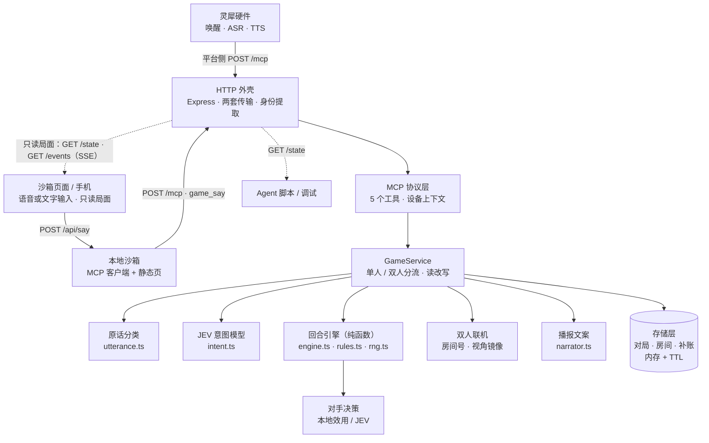

# 共鸣：闻声对决（linx-fighter）

[](https://codecov.io/gh/sorcerer-ma/linx-fighter)

> 灵犀语音硬件上的 1v1 回合制对战。玩家用嘴下令，服务端持有对局并裁定每一手；平台侧只负责听、说和调用工具。

中文名「共鸣：闻声对决」已定稿；仓库名、包名、`systemd` 单元与镜像名统一用 `linx-fighter`。

当前进度：**v0.2 玩法已落地**。七种招式、真气循环、伤害加成、先手补偿、AI 对手与双人联机（房间号 + 视角镜像）全部接通；结算由服务端唯一裁定，并用 PR 参考仿真的 256,000 局做数值对拍。规则与调参见 [docs/game-design.md](docs/game-design.md)。

灵犀只是载体，真正对外的是这套 MCP 服务。同一套服务端既接灵犀硬件，也接网页 / 手机：沙箱页面用同样的 `game_say` 说话，所以**换载体不改服务**——没有硬件时用手机或网页演示，接上硬件时同一套服务照常工作。

另带一个本地沙箱（[`sandbox/`](sandbox/README.md)）：在浏览器里模拟灵犀设备的输入与播报，可开多个窗口互相对战，也可以用命令行或脚本让 Agent 自己把整局打完——不依赖控制台与实体硬件，Agent 能在真实链路上自主模拟、自主回归。

双人局的补账播报：A 出招后，B 的应对在 B 自己的回合结算，A 当场听不到这一手的结果。平台没有服务端主动播报能力，服务端就等 A 下一次开口时补上——播报最前面会多一句「刚才那一手。你一记强攻，对手格挡，掉3点气血，剩15。」，再播当前这一回合。补过一次不重复，换局即清。这是给没有屏幕的终端准备的：客户端带 `X-Linx-Display: screen`（沙箱页面就是这样）就不念补账，自己去画局面。

## 一次语音出招是怎么走完的

1. 玩家对设备说「强攻」，灵犀平台完成唤醒与 ASR；
2. 平台把玩家原话交给智能体，智能体调用 MCP 工具 `game_say`，只做透传；设备与智能体身份通过请求头传入；
3. 服务端自己判断这句话想干什么：规则匹配优先，认不出再交给 JEV 意图模型归一化，最后按 `deviceId#agentId` 取出对局并推进一个阶段；
4. 对手出招后，玩家说「格挡」「闪避」或「承受」完成应对，服务端结算、判胜负、生成播报；
5. 平台把返回文本 TTS 给玩家，一回合结束。

判断与结算全部在服务端：平台侧模型不需要理解玩法、不需要记忆对局状态，也不改数值。

## 核心能力

- **完整回合制玩法**：普攻 / 强攻 / 大招 / 蓄力 / 格挡 / 闪避 / 承受；真气上限 5、主动阶段回气、第 3 轮起伤害加成、先手 14 血 / 后手 18 血、大招一局一次。
- **原话透传，判断在服务端**：平台把玩家原话原样交给 `game_say`，招式、战况、玩法、开局、开房都由服务端分类；规则认不出时才落到 JEV 意图模型，任何模型异常都当作没认出来，回合不丢。
- **语音即操作，不止认关键词**：口语别名（强攻 / 猛攻 / 抡、格挡 / 防御、承受 / 硬抗）、句中夹杂（「我要公鸡你」）、ASR 同音误识别（「公鸡」「工击」→ 普攻，「墙攻」「抢攻」→ 强攻，「大召」→ 大招）；每招另有中二唤出指令（「共鸣斩破军」「天倾共此声」），念出来会被回念一句。
- **认不出不吞回合**：无法识别时不推进回合、不改数值，只提示当前阶段可用的说法；配了 OpenRouter Key 时再叠一层 JEV 意图模型（decisions 接口，把「这句话对应哪一招」做成阶段内选择题），把「给我狠狠来一下」这类自由说法归一化成招式，规则匹配始终优先，模型失败/超时/低置信度都按没认出来处理。
- **JEV 决策对手**：每次出招与应对都把「当前局面 + 最近六条战报 + 玩家出招/应对习惯 → 合法选项」做成选择题交给 OpenRouter 的 JEV 决策模型（`typesafe/jev-1.13`），让模型能顺着局势预判玩家下一步；本地先按真气与大招次数过滤出合法选项，模型只能从里面选；选择越界、超时 1.2 秒或返回异常时回退本地效用决策，回合不会卡住，置信度与概率只写进日志。本地兜底策略见 [docs/ai-enemy.md](docs/ai-enemy.md)；`ENEMY_AI=local` 可整体关掉模型层。
- **双人联机**：说「联机」「开房间」得到 4 位房间号，对手说「加入房间1234」即可开打；平台模型没把这些词转成参数时，服务端也会从玩家原话里兜底识别。对局键仍是 `deviceId#agentId`，每个玩家看到自己的视角，服务端做镜像。
- **没有对局也能直接开口**：首句「普攻」自动开局，降低演示与试玩门槛。
- **对局按「设备 + 智能体」归属**：断线重连、多轮对话不丢对局；不同设备天然隔离。
- **两套传输并存**：Streamable HTTP（`POST /mcp`，平台实测走这条）与 SSE（`GET /mcp` 或 `/sse` + `POST /mcp/message`）；`DELETE /mcp` 直接 200，避免客户端收尾时报错。
- **为「听」而写的播报**：文案口语化、单次两句内，不用 Markdown、列表或 emoji——`content[].text` 会被原样念出来。
- **可替换的存储**：内存 + TTL，接口保持 `get/set/delete/sweep`，需要多实例时换 Redis 实现即可。

## 快速开始

```bash
pnpm install
pnpm dev        # tsx watch，默认 0.0.0.0:8000
pnpm demo       # 不连 MCP，直接看每个指令的播报
pnpm sandbox    # 沙箱：浏览器模拟器 + MCP 透传，默认 0.0.0.0:8100
```

服务起来后：

```bash
curl http://127.0.0.1:8000/health
pnpm smoke      # 真实调用链自检：initialize → tools/list → 开局 / 出招 / 战况 / 说明
```

其他常用命令：

```bash
pnpm typecheck     # 唯一的静态门禁（没有 lint）
pnpm test          # 单元测试 + MCP 协议端到端
pnpm coverage      # 覆盖率并校验阈值（行 95% / 分支 90% / 函数 95%）
pnpm coverage:lcov # 生成 coverage/lcov.info，供 Codecov 上传
pnpm validate      # 规则对拍：8 种策略 × 组合 2000 局，共 256,000 局
pnpm build         # 编译到 dist/
pnpm start         # 运行编译产物
pnpm sandbox       # 启动沙箱页面（需先起游戏服务）
pnpm sandbox:say   # 命令行说一句：pnpm sandbox:say --device web-a "强攻"（加 --voice 模拟无屏硬件）
pnpm sandbox:state # 打印某个设备看到的局面快照
pnpm sandbox:selfplay --rounds 3  # 两个脚本身份自动打完 3 局，顺带校验视角镜像
```

沙箱起来后，一个窗口就是一名玩家：

```bash
open 'http://localhost:8100/?player=1'   # 说「开房间」，拿到 4 位房间号
open 'http://localhost:8100/?player=2'   # 说「加入房间XXXX」，两人开打
```

手机连同一内网打开 `http://<电脑内网 IP>:8100/?player=3` 就是第三名玩家；页面里的局面走 `/events` 实时刷新，输入仍然只有语音和文字一条路。浏览器只在 HTTPS 或 localhost 下给麦克风，局域网 HTTP 打开时页面会降级成文字输入（详见 [sandbox/README.md](sandbox/README.md)）。

## MCP 接口

### 工具

| 工具 | 玩家说法 | 说明 |
| --- | --- | --- |
| `game_say` | 玩家的任何一句话 | **统一入口**：把原话一字不改放进 `text`，服务端自己判断是出招、查战况、看玩法还是开局；平台侧模型不用做选择 |
| `game_start` | 「开始游戏」「来一局」「联机」「加入房间1234」 | 开一局新对局，覆盖未结束的旧对局；`mode: "pvp"` 建房，`room` 加入房间，`text` 可放玩家原话由服务端兜底识别，`opponent` 指定单人对手 |
| `game_action` | 「强攻」「格挡」「闪避」「共鸣斩破军」 | 识别招式并推进一个阶段，返回播报 |
| `game_status` | 「战况如何」「我还剩多少血」 | 播报双方气血、真气与当前阶段 |
| `game_help` | 「怎么玩」 | 播报玩法说明 |

工具总数刻意控制在 5 个以内：平台侧模型工具越多越容易选错。推荐把 `game_say` 当成唯一入口，其余四个作为它的兜底。

### 端点

| 端点 | 方法 | 用途 |
| --- | --- | --- |
| `/mcp` | POST | Streamable HTTP：直接收发 JSON-RPC，响应为 JSON |
| `/mcp`、`/sse` | GET | 建立 SSE 长连接，先推 `endpoint` 事件给出 POST 地址 |
| `/mcp/message?sessionId=<id>` | POST | 老式 SSE 通道：接收 JSON-RPC，响应从 SSE 流返回 |
| `/mcp` | DELETE | 会话收尾，直接返回 200 |
| `/health` | GET | 健康检查：状态、对局数、房间数、运行时长 |
| `/state?device=&agent=` | GET | 某位玩家视角的局面快照（JSON），供沙箱与 Agent 自主模拟 |
| `/events?device=&agent=` | GET | SSE 状态流：局面变化时推 `event: state`，15 秒一次心跳注释；跨域开放，手机页面可直连 |
| `/debug/*` | GET/POST | 调试接口：`start` / `action` / `status` / `state`，默认仅非生产环境开启；`start` 支持 `mode` 与 `room` |

### 身份

设备与智能体身份由平台在请求头注入，**不进工具入参**：

| 请求头 | 含义 |
| --- | --- |
| `X-Linx-Device-Id` | 设备 ID，对局归属的主要依据 |
| `X-Linx-Agent-Id` | 智能体 ID，同一设备换智能体就是另一局 |
| `X-Linx-Session-Id` | 会话 ID，每轮对话刷新 |
| `X-Linx-Display` | 载体有没有屏幕：`voice`（默认，无屏终端）或 `screen`（有屏客户端）。`screen` 关掉补账播报，局面由客户端自己展示 |

### 返回

```json
{
  "content": [{ "type": "text", "text": "你一记强攻，对手格挡，只掉了3点气血，还剩12点。轮到你应对。" }],
  "isError": false
}
```

`text` 就是念给玩家的话。工具不抛异常：业务错误统一转成 `isError: true` + 一句玩家能听懂的中文。

## 语音容错

ASR 在平台侧，同音与近音错误只能由我们兜住。识别按「整句精确 → 子串包含」两段式匹配，包含匹配里长说法优先（避免「闪开」被「闪」截胡）。新增招式时同时补口语别名与常见误识别样例。

| 招式 | 口语别名（节选） | 唤出指令 | 常见误识别 |
| --- | --- | --- | --- |
| 普攻 light | 打、砍、斩、劈、揍、出手 | 共鸣斩破军、音波裂空 | 公鸡、工击、攻鸡、公机 |
| 强攻 heavy | 猛攻、重击、大招之外的硬拼 | 千军共鸣、裂帛之势 | 墙攻、抢攻、抢功、强工 |
| 大招 ult | 绝招、必杀、奥义 | 天倾共此声、万籁俱鸣 | 大召、大照、大招儿、大沼 |
| 蓄力 charge | 聚气、调息、攒气、运功 | 归元纳息、回响充能 | 回七、蓄汽、续力、续利、聚汽 |
| 格挡 guard | 防御、挡、架招、护体 | 声海化金汤、共鸣成壁 | 哥挡、鸽挡、隔挡、各挡 |
| 闪避 dodge | 躲、闪、躲开、闪开 | 流光换位、回声疾步 | 闪币、朵开、多开、闪闭 |
| 承受 take | 硬扛、硬吃、不躲、吃伤害 | — | 成受、乘受、承受伤害、成兽 |

匹配规则集中在 `src/game/actions.ts`；一个唤出词只映射一招，单字别名「打」「躲」只走整句精确匹配，不会误伤。

## 架构设计

整套服务的形状由三条前提推出来：

1. **语音只有一条窄通道**：一次最多听两句、不能回头翻记录，所以信息必须由服务端替玩家记住并挑重点说。
2. **对局只能有一个判断者**：判断与结算全在服务端，平台侧模型只做透传与朗读。换模型、换提示词、换载体都不影响对局正确性。
3. **演示优先、单实例够用**：内存存储与单进程足够撑现场演示，不引入数据库、消息队列与多实例状态同步。

其余设计都是这三条的推论。

### 分层与依赖方向

依赖只允许自上而下：`http` → `mcp` → `game` → `store`。领域层（规则、策略、联机、播报、分类、视图）不 import MCP 或 HTTP，因此 `scripts/demo.ts`、`scripts/validate-v02.ts` 可以脱离协议直接跑玩法与对拍。



### 各层职责

| 层 | 文件 | 职责 | 边界 |
| --- | --- | --- | --- |
| 接入层 | `src/http/app.ts` | 两套 MCP 传输、身份提取、`/state` 与 `/events` 旁路、健康检查、调试接口、错误兜底 | 不判断玩法 |
| 协议层 | `src/mcp/server.ts`、`src/mcp/tools.ts` | 工具注册与参数校验、把异常转成 `isError` + 一句人话 | 不做业务分支 |
| 编排层 | `src/game/service.ts` | 开局 / 出招 / 战况 / 说明，单人双人分流，读改写存储，补账播报 | 不算数值 |
| 规则层 | `src/game/engine.ts`、`rules.ts`、`rng.ts` | 创建对局、双阶段结算、胜负，纯函数，随机数由 seed 派生 | 不感知协议 |
| 策略层 | `src/game/enemy.ts`、`enemy-jev.ts`、`intent.ts` | 对手决策与「这句话是哪一招」的归一化，只选动作 | 不产出数值、不改状态 |
| 联机层 | `src/game/pvp.ts`、`src/store/rooms.ts` | 房间号、视角镜像与写回、事件换视角 | 不复制引擎 |
| 表现层 | `src/game/narrator.ts` | 为「听」写的播报，只依赖对局状态与事件 | 不拼业务判断 |
| 分类与视图 | `src/game/utterance.ts`、`state.ts` | 原话分类（招式 / 战况 / 玩法 / 开局）与界面用的局面快照 | 不写状态 |
| 存储层 | `src/store/battles.ts`、`rooms.ts`、`echoes.ts` | 对局、房间、补账的读写与过期清理 | 不做结算 |

### 一次请求的完整路径

1. 平台或沙箱 `POST /mcp`，JSON-RPC 带 `X-Linx-Device-Id` / `X-Linx-Agent-Id` / `X-Linx-Session-Id` / `X-Linx-Display`；
2. 接入层建临时 `McpServer`（无状态传输）→ 协议层取出 `deviceId#agentId` 作为对局键 → `game_say(text=原话)`；
3. `GameService.say()` 先 `classifyUtterance`：招式 → `act`，战况 / 玩法 / 开局直接回，剩下的一律交给 `act` 兜底（含开房、加入房间、自动开局）；
4. `act` 按是否在房间里分流：单人走本地 AI，双人按视角镜像后结算；
5. 规则层 `resolveTurn` 推进一个阶段并返回新状态与事件；认不出招式时**不推进回合**，只提示当前可用的说法；
6. 表现层把事件拼成最多两句中文，双人局顺带把出手方错过的结算记进补账队列，然后原样作为 `content[].text` 返回，由平台 TTS 念给玩家；
7. 旁路：页面用 `EventSource` 订阅 `GET /events` 拿只读局面，脚本用 `GET /state` 拿同一份快照——两者都不参与判断。

### 对局状态机

对局的几个关键状态，靠 `battle.active` 与 `battle.pending` 区分：

| 状态 | 判定（按当前玩家视角） | 玩家能做什么 |
| --- | --- | --- |
| 轮到玩家出招 | `pending === null && active === 'player'` | 普攻 / 强攻 / 大招 / 蓄力，或问战况 / 玩法 |
| 等玩家应对 | `pending.actor === 'enemy'` | 格挡 / 闪避 / 承受 |
| 攻击已锁定、等对手应对 | `pending.actor === 'player'` | 只能等（补账播报此时不记，等这一轮真正结算完再记） |
| 终局 | `phase !== 'battle'` | 看播报与结算，说「开始」「再来一局」重开 |

双人局每次成功结算后 `active` 都会翻到另一方，所以「此刻该开口的人」永远是没在场的那个——补账播报就是在这个缝里补的。

### 关键设计决策一览

| # | 决策 | 理由摘要 |
| --- | --- | --- |
| 1 | Streamable HTTP 与 SSE 两套传输并存 | 平台实测走 `POST /mcp`，早期文档描述的是 SSE；两套共用存储，按方法分流 |
| 2 | 对局键 = `deviceId#agentId` | 会话每轮都变，按会话存会让玩家「失忆」 |
| 3 | 存储用内存 + TTL，接口保持可替换 | 单实例够用；换 Redis 时只替换构造，`GameService` 不动 |
| 4 | 工具返回纯文本，不返回 `structuredContent` | 现阶段没有设备动作，纯文本对平台侧模型最稳 |
| 5 | 随机数全部由对局 seed 派生 | 同一 seed 逐位复现，256,000 局对拍才有意义 |
| 6 | 双人用视角镜像，不复制引擎 | 结算逻辑只有一份，`viewAs` / `canonicalize` 负责换视角与写回 |
| 7 | 认不出招式不消耗回合 | 语音误识别是常态，凭空掉血比重说一次更糟 |
| 8 | 首句出招自动开局 | 玩家第一句往往是「攻击」而不是「开始游戏」 |
| 9 | 每个 SSE 连接一个 `McpServer` | 协议状态按连接保存，共用实例会串会话 |
| 10 | 工具错误不外抛 | 转成 `isError: true` + 人话，避免平台侧模型拿到协议错误后乱编 |
| 11 | JEV 只做选择题，规则优先 | 模型只从合法选项里选，超时 / 越界 / 低置信度一律回退，断网也能玩 |
| 12 | 原话透传（`game_say`） | 平台侧模型每多一个选择就多一次选错；判断依据本来就在服务端 |
| 13 | 状态流用 SSE 而不是 WebSocket | 单向、低频、浏览器自带重连；WebSocket 只在双向低延迟输入时才值得 |
| 14 | 沙箱独立进程、走真实 MCP 入口 | 它跑通的链路就是玩家会走的链路；坏了只能怪自己的 bug |
| 15 | 补账播报 + `X-Linx-Display` 协商 | 无屏终端需要补，有屏客户端自己能看；能力走请求头，不进工具入参 |

每条决策的来龙去脉、替代方案与否决原因见 [docs/architecture.md](docs/architecture.md)。

### 载体与沙箱的位置

灵犀硬件只是载体，真正对外的是这套 MCP 服务。任何新载体只需要回答两个问题：**怎么把玩家的话送进来**（调 `game_say`）、**怎么把结果呈现出去**（念出来，或画出来）。请求头 `X-Linx-Display` 就是载体能力的声明：`voice` 保留补账播报，`screen` 关掉、由客户端自己画局面。

`sandbox/` 是这台「替身设备」：页面把原话交给沙箱，沙箱像平台一样只发 HTTP 调 `game_say`，不 import 服务端内部函数。所以多窗口对战、手机访问、Agent 用脚本自己打完整局，走的都是真实链路。详见 [sandbox/README.md](sandbox/README.md)。

### 扩展点

| 想改什么 | 改哪里 |
| --- | --- |
| 招式、口语别名、ASR 误识别、唤出短语 | `src/game/types.ts` 的 `ActionId` + `src/game/actions.ts` 的 `ACTIONS` |
| 数值（气血、真气、伤害、暴击、闪避） | `src/game/rules.ts`，同步 `docs/game-design.md` 并重跑 `pnpm validate` |
| 回合结算与胜负 | `src/game/engine.ts` 的 `resolveTurn` |
| 对手 AI | `src/game/enemy.ts`（本地兜底）、`src/game/enemy-jev.ts`（JEV 决策） |
| 双人房间与视角 | `src/game/pvp.ts`、`src/store/rooms.ts` |
| 意图模型 | `src/game/intent.ts`（提示词与阈值在 `actions.ts` / `intent.ts`） |
| 播报文案 | `src/game/narrator.ts` |
| 业务流程（开局 / 出招 / 战况 / 说明） | `src/game/service.ts` |
| 工具定义与参数 | `src/mcp/tools.ts`、`src/mcp/server.ts` |
| 路由、传输、请求头 | `src/http/app.ts`、`src/mcp/context.ts` |
| 存储 | `src/store/battles.ts`、`src/store/rooms.ts`、`src/store/echoes.ts` |
| 换存储 / 多实例 | 实现同签名的 `get/set/delete/sweep`，在 `src/index.ts` 替换构造；多实例还要考虑会话粘滞 |

### 有意不做的事

演示前刻意不做：多实例与 Redis、账号体系、关系型数据库、可观测性平台、容器编排、前端框架。沙箱页是「前端」的唯一例外——它的定位是设备替身，不是产品界面，所以零依赖、零构建、零 CDN。

## 配置

全部来自环境变量，参考 `.env.example`：

| 变量 | 默认值 | 说明 |
| --- | --- | --- |
| `PORT` | `8000` | 监听端口 |
| `HOST` | `0.0.0.0` | 监听地址 |
| `LOG_LEVEL` | `info` | `debug` / `info` / `warn` / `error`，日志为单行 JSON |
| `BATTLE_TTL_SECONDS` | `1800` | 对局与房间的空闲过期时间 |
| `ENABLE_DEBUG_ENDPOINTS` | 非生产环境开启 | 是否暴露 `/debug/*` |
| `OPENROUTER_API_KEY` | 空 | 配置后启用 JEV 意图模型（OpenRouter decisions 接口）；为空只用规则匹配 |
| `OPENROUTER_MODEL` | `typesafe/jev-1.13` | JEV 决策模型名 |
| `INTENT_TIMEOUT_MS` | `1500` | 意图模型超时，超时按没认出来处理 |
| `ENEMY_AI` | `jev` | 对手 AI：`jev` 走 JEV 决策，`local` 只用本地决策模型 |
| `ENEMY_TIMEOUT_MS` | `1200` | 对手单次决策超时，超时回退本地 |

## 测试与质量

[](https://codecov.io/gh/sorcerer-ma/linx-fighter)

`node:test` + 内置覆盖率，不引入额外测试框架。当前 **229 个用例**，行覆盖 **99.2%**、分支覆盖 **94.3%**、函数覆盖 **98.8%**；CI 与本地 `pnpm coverage` 都会校验阈值（行 95% / 分支 90% / 函数 95%），低于阈值直接失败。CI 用 `pnpm coverage:lcov` 生成 lcov 并上传 Codecov（公开仓库无需 token；私有仓库在仓库 secrets 配 `CODECOV_TOKEN`）。

| 测试 | 覆盖内容 |
| --- | --- |
| `test/actions.test.ts` | 七招表、精确与包含匹配、ASR 误识别、唤出指令唯一性、空输入 |
| `test/engine.test.ts` | 初始化与先手、伤害/暴击/格挡/闪避、强制承受、真气与大招限制、轮次加成、胜负、纯函数与 seed 复现、双人 pending |
| `test/enemy.test.ts` | 本地 AI 主动/应对决策、斩杀优先、保大招、血线攒气、致死规避 |
| `test/enemy-jev.test.ts` | JEV 对手决策：合法选项过滤、题干（含战报与习惯）、解析、低置信度/超时/异常回退 |
| `test/intent.test.ts` | JEV decisions 返回解析、置信度阈值、阶段校验、请求体与失败回退 |
| `test/narrator.test.ts` | 播报两句与 60 字约束、各事件、终局、房间与战况文案 |
| `test/utterance.test.ts` | 原话分类：招式 / 战况 / 玩法 / 开局 / 认不出，以及各条边界说法 |
| `test/state.test.ts` | 局面快照字段、等对手标记、中文标签、视角镜像、胜负折算与幂等 |
| `test/pvp.test.ts` | 建房/加入、视角镜像、双人出招与应对、房间校验、超时、结算事件镜像 |
| `test/rooms.test.ts` | 房间号生成与复用、加入/满员/重复加入、玩家索引、过期清理 |
| `test/service.test.ts` | 开局 / 出招 / 战况 / 说明、单人 AI 先手、错误文案、双人分流、补账播报 |
| `test/simulation.test.ts` | MT19937 复现 + 2000 局镜像快速对拍 |
| `test/config.test.ts` | 环境变量解析、默认值与非法值回退 |
| `test/context.test.ts` | 请求头到身份、对局键、头缺失时的兜底 |
| `test/store.test.ts` | 内存存储读写、TTL 过期、容量上限 |
| `test/echoes.test.ts` | 补账消息：取走即清空、按序攒着、互不影响、过期与清理 |
| `test/log.test.ts` | 级别过滤、单行 JSON 输出、stderr 分流 |
| `test/tools.test.ts` | 工具注册与业务异常转 `isError` |
| `test/http.test.ts` | 路由、健康检查、SSE 握手、调试接口（含双人房）、404 与非法 JSON |
| `test/streamable.test.ts` | Streamable HTTP：initialize / tools/list / tools/call |
| `test/mcp.e2e.test.ts` | 完整对局链路、多设备隔离、无对局自动开局、双人房、`game_say` 单工具走完全流程 |
| `test/sandbox.test.ts` | 沙箱服务：配置、透传、快照、工具列表、上游不可达与 trace |

规则对拍单独跑：`pnpm validate` 会用纯 TS 复刻 PR 参考仿真的 8 种策略、各组合 2000 局（共 256,000 局），与 `test/fixtures/v02-validation.json` 逐项比对，任何数值、随机数或结算顺序漂移都会以非零退出码失败。CI 在 [.github/workflows/ci.yml](.github/workflows/ci.yml)：安装依赖 → 类型检查 → 覆盖率门禁 → 规则对拍 → 生成 lcov 并上传 Codecov → 构建产物。

## 部署

演示环境跑在七牛云内网机器 `100.100.61.41`（`linx-fighter.service`，用户 `linx`，代码在 `/opt/linx-fighter`）。内网地址 `http://100.100.61.41:8000/mcp` 平台访问不到，另用 `linx-tunnel.service`（bore 内网穿透）暴露到公网，控制台填 **`http://bore.pub:3216/mcp`**。

```bash
scripts/deploy.sh                 # 编译 → 同步 → 装生产依赖 → 重启 → 自检
systemctl status linx-fighter     # 应用状态
journalctl -u linx-fighter -f     # 实时日志
systemctl status linx-tunnel      # 隧道状态（实际端口见 journalctl -u linx-tunnel）
```

也可以用 Docker：

```bash
docker build -t linx-fighter .
docker run -d --name linx-fighter -p 8000:8000 linx-fighter
```

> bore 公网地址随机分配、随隧道重建变化，仅适用于内部演示；正式上线需要自建反向代理与 TLS，并关闭对 SSE 的缓冲（配置见 [docs/linx-integration.md](docs/linx-integration.md)）。

## 接入灵犀平台

部署、自检、控制台里配置自定义 MCP、智能体设定与可直接粘贴的提示词模板，都在 [docs/linx-integration.md](docs/linx-integration.md)。

## 文档

| 文档 | 内容 |
| --- | --- |
| [README.md](README.md) | 现状、命令、接口、部署 |
| [docs/architecture.md](docs/architecture.md) | 逐条设计决策的来龙去脉、替代方案与扩展指引（总览见上文「架构设计」） |
| [docs/game-design.md](docs/game-design.md) | v0.2 规则、数值、AI、双人联机与验证 |
| [docs/ai-enemy.md](docs/ai-enemy.md) | AI 决策模型、权重与自博弈结果 |
| [docs/design-references.md](docs/design-references.md) | 同类设计案例：读招、资源、节奏与先手补偿 |
| [sandbox/README.md](sandbox/README.md) | 本地沙箱：多窗口模拟、Agent 脚本驱动、接口契约、手机语音 |
| [docs/linx-integration.md](docs/linx-integration.md) | 平台接入、提示词、排障 |
| [AGENTS.md](AGENTS.md) | 给 AI 协作者的仓库规范 |

`docs/xrobot-dev-spec/` 是灵犀平台官方开发文档的整份拷贝（含大量图片）：**不入库**、只读、按需单篇查阅。新克隆的仓库没有这份拷贝，需要时从 [linx.qiniu.com/docs/xrobot](https://linx.qiniu.com/docs/xrobot/) 同步到本地。

## 目录结构

```
src/
  index.ts            启动入口：装配依赖、监听端口、优雅退出
  config.ts           环境变量解析
  log.ts              单行 JSON 日志
  game/
    types.ts          数据模型：Fighter / Battle / TurnRecord / 事件
    actions.ts        七招定义、口语别名、ASR 容错与唤出指令
    rules.ts          数值表：气血、真气、伤害、暴击、闪避
    rng.ts            由 seed 派生的可复现随机数
    engine.ts         创建对局、双阶段结算与胜负（纯函数）
    enemy.ts          本地对手决策模型（JEV 失败时兜底）
    enemy-jev.ts      JEV 决策对手：把合法招式做成选择题
    intent.ts         JEV 意图模型：自然语言归一化招式（规则优先）
    pvp.ts            双人视角镜像与房间号工具
    narrator.ts       播报文案
    utterance.ts      玩家原话分类：招式 / 战况 / 玩法 / 开局
    state.ts          局面快照：给界面与脚本直接消费
    service.ts        游戏编排：单人/双人分流
  mcp/
    context.ts        设备上下文与对局归属键
    server.ts         McpServer 创建与 instructions
    tools.ts          工具注册
  http/app.ts         路由：Streamable HTTP / SSE、状态流、健康检查、调试接口
  store/
    battles.ts        对局存储（内存 + TTL）
    rooms.ts          房间存储与玩家索引
    echoes.ts         双人补账：出手方错过的结算，等他下次开口再念
sandbox/
  server.ts           沙箱服务：静态页 + /api/say 透传 + 状态流代理
  cli.ts              命令行说一句 / 看局面 / 列工具
  selfplay.ts         两个脚本身份自动打完一局并校验视角镜像
  platform/           手写 MCP 客户端与沙箱客户端（逐请求 trace）
  public/             浏览器里的灵犀模拟器（语音 + 文字 + 只读战况）
scripts/
  demo.ts             脱离 MCP 直接跑播报
  smoke.ts            真实调用链自检
  validate-v02.ts     256,000 局规则对拍
  deploy.sh           内网部署脚本
test/
  helpers/            MT19937、仿真策略与夹具
  fixtures/           v02-validation.json
  *.test.ts           单元测试 + MCP 端到端
docs/                 架构、玩法、AI、接入文档与平台官方文档
```

## 下一步

1. 数值平衡与播报打磨，调参理由写进 `docs/game-design.md`，并重跑 `pnpm validate`。
2. 意图模型与对手决策的提示词、阈值调优（真实 Key 下的选择质量与延迟）。
3. 双人断线重连提示、房间内再来一局、观战与回放。
4. 按需扩展：Redis 存储、对局结算音效（`structuredContent.funcs` 触发 `linx_play`）。
