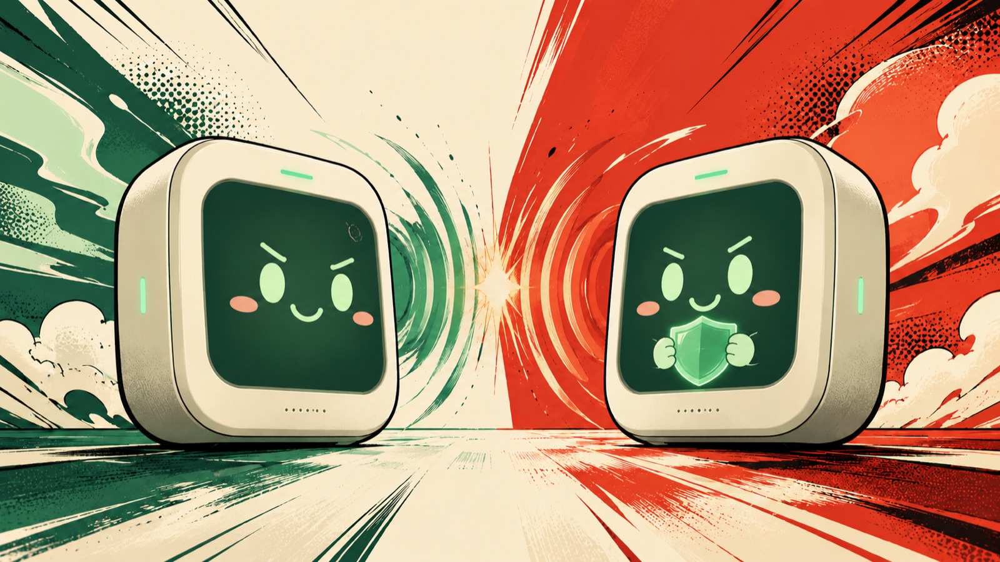

<p align="center">
  
</p>

<h1 align="center">共鸣：闻声对决</h1>

<p align="center">
  <strong>开口，就是操作。</strong><br />
  灵犀语音硬件上的 1v1 回合制对战。两位玩家、两台设备、一张桌子，招式全靠一张嘴。
</p>

<p align="center">
  
  
  
  
  <a href="https://codecov.io/gh/sorcerer-ma/linx-fighter"></a>
</p>

<p align="center">
  
</p>

## 这是什么

《共鸣：闻声对决》是一款用嘴打的回合制对战游戏。

你和朋友面对面坐着，各对着一台灵犀设备说话：强攻、格挡、闪避、蓄力、开大。住在设备里的共鸣精灵会替你出手，也会把战况讲给你听——掉了多少生命值、攒了多少能量、轮到谁动、下一手该怎么防。

没有手柄，没有技能栏，也没有「匹配陌生人」的房间。你唯一的操作，就是开口。

> **共鸣**，是玩家与精灵之间彼此信任、互相回应的那点默契；**闻声**，是这一整场战斗只靠声音进行。

游戏跑在一套服务里，硬件、网页和手机都能接进来：有屏就看界面，没屏就听播报。

## 你的伙伴

每台设备里住着一只**共鸣精灵**，名字可以由你定，只属于它。它不是玩家的武器，也不是玩家的替身——你坐在它身边，它替你在场上行动。

> 「在《共鸣：闻声对决》的世界里，共鸣精灵能从声音中感受到勇气与信任，日常也简称『精灵』。你是其中之一，与玩家因为彼此的回应而结伴。玩家观察局势、给出指挥，你在场上行动，坦率表达自己的紧张、疼痛与得意。」
>
> 「闻声对决是伙伴之间的友好较量：练习默契、认识对手、找到勇气，不以伤害彼此为目的。『共鸣』不是盲从，而是信任中的回应；胜利时一起欢呼，失利也不会改变你们的伙伴关系。你愿意听取玩家的指挥，但不会擅自替玩家出招或编造行动结果。」
>
> —— 摘自伙伴设定

- **它替你打，也替你疼**：生命值是伙伴的，不是你的。你负责判断和开口，它负责承受、还手和把这一局讲完。
- **它是共鸣精灵，不是系统代理**：不主持、不裁判，也不擅自替你出招或编造战果；你负责观察和指挥，它负责上场和承担。
- **有自己的脾气**：命中时得意，挡下时安心，闪避成功时俏皮，挨打时龇牙；输了还会想再来一局。不卖萌过头，也不当客服。
- **只对事实有反应**：不提前喊命中、闪避或胜负，不虚报生命值，不替对手脑补策略。报给你的每个数字都来自服务端的裁决。
- **叫你「你」，对面叫「对手」**：不称「主人」，不自称工具、模型或助手。它是个角色，不是个功能。
- **大招要喊出来**：能量攒满、服务端确认发动的那一刻，它才会喊出「共鸣冲击」。

## 一局怎么打

1. **开场**：一方说「共鸣对决，发起挑战」，伙伴报出四位房间编号；另一方说「接受挑战，编号 1234」，两台设备就坐上了同一张桌子。
2. **轮流出招**：先手方选择普攻、强攻、蓄力或大招；后手方再选择格挡、闪避或承受，两边都动完算一轮。
3. **见招拆招**：后手多 4 点生命值，换先手先动；能量是唯一的预算，第 3 轮起伤害逐步加成，拖得越久越疼。
4. **分出胜负**：任意一方生命值归零，这一局立即结束。伙伴会把结果讲完，再问你要不要再来。

| 招式 | 可以这样说 | 消耗 | 作用 |
| --- | --- | --- | --- |
| 普攻 | 普攻、攻击、打 | 1 能量 | 3 点伤害，便宜稳定 |
| 强攻 | 强攻、重击、大力攻击 | 2 能量 | 5 点伤害，主力输出 |
| 大招 | 大招、绝招 | 4 能量 | 9 点伤害，一局一次；被闪避也不返还 |
| 蓄力 | 蓄力、回气 | — | 放弃这次出手，能量 +1 |
| 格挡 | 格挡、防御 | 1 能量 | 这一下伤害 −2 |
| 闪避 | 闪避、躲开 | 1 能量 | 按招式概率完全免伤 |
| 承受 | 承受、硬抗 | — | 硬吃全额伤害，把能量留到下一手 |

招式还有暴击与闪避概率，完整数值、结算顺序与对局状态见[玩法机制](docs/game/game-design.md)。

## 为什么值得玩

- **真的只用一张嘴**。没有技能栏，没有手柄，也没有「确认/取消」。没听清、说得含糊，或者你明确否掉这一手，都不会扣血或浪费回合，重说一遍就好。
- **读招比手速重要**。出招和应对是两段独立博弈：进攻时要赌对面挡、闪还是硬吃；防守时知道来招，却要在挡、闪和攒能量之间算账。每一手都在赌下一步。
- **每台设备一只精灵**。共鸣精灵有自己的性格和情绪，会在关键回合催你，也会在输了之后说「再来」。硬件因此不是音箱，而是坐在你旁边的伙伴。
- **面对面，不是匹配**。四位编号就能把朋友的设备拉进同一张桌子，适合线下、展台和朋友局。
- **听不清也接得住**。同音误识别、否定句、问句、一句里冒出好几个招式，都有各自的兜底；不会因为一句「不要打」就稀里糊涂掉了血。
- **没屏也能玩**。错过的结算会在下次出招或查战况时补念；有屏时只在界面上更新，不重复念旧账。

## 现在做到哪了

v0.2 的双人闭环已经跑通：单人打 AI、双人房间、七种招式、能量与胜负裁决、无屏补账、只读后台看板、沙箱整局自对弈。

- **已验证**：规则与并发、MCP v2 两工具与 JSON 事实、沙箱页面链路，以及两台浏览器/手机在沙箱里打完一整局。
- **待验收**：真实硬件上的唤醒、ASR 与 TTS，平台侧提示词与 wait_event 长请求行为，以及现场噪声、多人说话与设备摆放。仓库测试与沙箱通过，不等于真机体验已经通过。
- **还没做**：设备的灯光、表情与动作反馈；更多共鸣精灵与线上对战。

## 五分钟玩一局

需要 Node.js ≥ 20 与 pnpm，没有硬件也能玩：

```bash
pnpm install
pnpm dev          # 终端 1：游戏服务
pnpm sandbox      # 终端 2：沙箱页面
```

打开 <http://127.0.0.1:8100>，用页面上的「＋ 新窗口」开第二个窗口。A 说「共鸣对决，发起挑战」，B 说「接受挑战，编号 1234」，就可以开打。

手机和电脑在同一 Wi-Fi 时，用 `http://<电脑 IP>:8100` 打开另一块屏。不想开两个窗口，也可以让两个假玩家自己打：

```bash
pnpm sandbox:selfplay --rounds 3
```

不配置任何模型密钥也能完整对局——规则、对手和播报都有本地实现。完整操作、接口与排障见[沙箱说明](docs/testing/sandbox.md)。

## 文档

| 想了解 | 从这里读 |
| --- | --- |
| 产品定位、玩家旅程与体验目标 | [产品设计](docs/product/product-design.md) · [玩家旅程](docs/product/player-journey.md) |
| 战斗规则、数值与招式说法 | [玩法机制](docs/game/game-design.md) |
| 架构、关键决策与仓库布局 | [架构与设计决策](docs/engineering/architecture.md) |
| 工具、端点、身份头与返回格式 | [MCP 接口](docs/engineering/mcp-api.md) |
| MCP 事实协议与迁移记录 | [协议设计](docs/engineering/mcp-protocol.md) · [迁移说明](docs/engineering/mcp-v2-migration.md) |
| 本地开发、命令与调试入口 | [开发与运行](docs/engineering/development.md) |
| 平台配置、部署与排障 | [接入灵犀平台](docs/engineering/linx-integration.md) |
| 本地沙箱、手机联调与用例 | [沙箱说明](docs/testing/sandbox.md) |
| 测试矩阵与质量门禁 | [测试与质量](docs/testing/testing.md) |
| 真机验收与试玩记录 | [验收与试玩](docs/product/acceptance-and-playtest.md) |
| 多设备、声纹与归属 | [多设备归属](docs/product/multi-device-attribution.md) |
| 同类产品与设计依据 | [设计参考](docs/references/design-references.md) |

## 参与开发

- 动手前先读 [AGENTS.md](AGENTS.md)：分支、提交、验证与文档同步的约定都在那里，模块入口与「改什么看哪里」也在其中。
- 改规则或数值，先读[玩法机制](docs/game/game-design.md)并跑 `pnpm validate`；改协议，先对齐 [MCP 接口](docs/engineering/mcp-api.md) 与 [v2 设计](docs/engineering/mcp-protocol.md)；改沙箱或链路，按[测试与质量](docs/testing/testing.md)补齐对应验证。
- 提交前至少通过 `pnpm typecheck` 与受影响的测试；涉及规则、并发或协议时，同时通过覆盖率与对拍门禁。
- 文档与实现同一次提交更新。建议、未决事项与已验证能力分开写，不把「计划中」写成「已交付」。

## 下一步

- **上真机**：把唤醒、ASR 与 TTS 在真实硬件和现场噪声里跑通，完成演示前的验收。
- **平台落地**：把 v2 提示词、`wait_event` 与语音链路在灵犀平台配置好，用真机日志确认真实能挂多久。
- **让精灵被看见**：用灯光、表情和动作回应战局，让它的脾气不只停在声音里。
- **更多共鸣精灵与线上对战**：一台硬件承载多只精灵、跨地点匹配，是更长期的方向。

---

<p align="center"><sub>共鸣：闻声对决 · linx-fighter · 让声音成为唯一的操作</sub></p>
