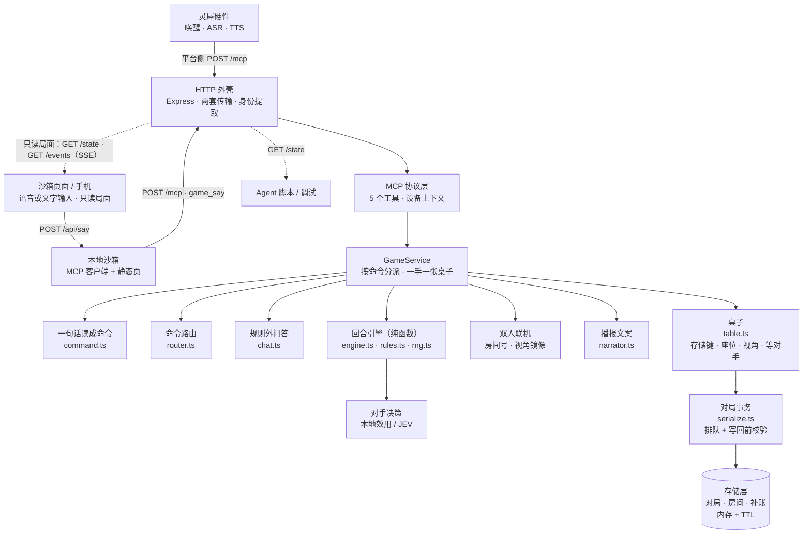

# 共鸣：闻声对决（linx-fighter）


> 灵犀语音硬件上的 1v1 回合制对战。玩家用嘴下令，服务端持有对局并裁定每一手；平台侧只负责听、说和调用工具。

中文名「共鸣：闻声对决」已定稿；仓库名、包名、`systemd` 单元与镜像名统一用 `linx-fighter`。

当前进度：**v0.2 玩法已落地**。七种招式、能量循环、伤害加成、先手补偿、AI 对手与双人联机（房间号 + 视角镜像）全部接通；结算由服务端唯一裁定，并用 PR 参考仿真的 256,000 局做数值对拍。玩家术语统一为生命值与能量；旧资源说法仅兼容输入，`hp`/`ap` 等技术字段保持不变。规则与调参见 [docs/game/game-design.md](docs/game/game-design.md)。

灵犀只是载体，真正对外的是这套 MCP 服务。同一套服务端既接灵犀硬件，也接网页 / 手机：沙箱页面用同样的 `game_say` 说话，所以**换载体不改服务**——没有硬件时用手机或网页演示，接上硬件时同一套服务照常工作。

另带一个本地沙箱（[`sandbox/`](docs/testing/sandbox.md)）：在浏览器里模拟灵犀设备的输入与播报，可开多个窗口互相对战，也可以用命令行或脚本让 Agent 自己把整局打完——不依赖控制台与实体硬件，Agent 能在真实链路上自主模拟、自主回归。

双人局的补账播报：A 出招后，B 的应对在 B 自己的回合结算，A 当场听不到这一手的结果。当前没有 `wait_event`，也没有无请求主动播报通道，服务端等 A 下一次行动或查询战况时补上——播报最前面会多一句「刚才那一手。我强攻，对手格挡，掉3点生命值，剩15。」，再播当前这一回合。补过一次不重复，换局即清。这是给没有屏幕的终端准备的：客户端带 `X-Linx-Display: screen`（沙箱页面就是这样）就不念补账，自己去画局面。

已合并 [MCP v2 事实协议](docs/engineering/mcp-protocol.md)，**尚未实现**：目标是服务端返回事实、Agent 演绎，再播放最终话术。下述工具与链路描述当前 main；两工具、JSON 事实与 `wait_event` 均不能当作已运行能力。当前文本兼容沙箱与目标协议的切换依赖及验收见 [迁移实施说明](docs/engineering/mcp-v2-migration.md)。

## 产品定位与体验目标

硬件是玩家的战斗伙伴。两名玩家各自通过语音指挥自己的伙伴，选择进攻或防守，与另一名玩家控制的伙伴战斗，击倒对方取得胜利。玩家负责战术选择，伙伴负责接收指令、呈现状态和反馈战况，服务端统一裁决结果。

首个试玩场景是两名玩家面对面、各用一台设备：一方开房并告诉对手房间号，另一方加入，随后按阶段轮流出招和应对。没有实体硬件时，可用沙箱的两个浏览器窗口或手机模拟这条链路；单人模式提供 AI 对手。

体验目标是让玩家听得懂当前阶段、清楚自己的指令是否生效，并围绕能量分配、防守风险和唯一一次大招的时机作选择。双方生命值、能量和大招剩余次数属于公开信息；喊话音量、速度和抢话不提供战斗加成。

早期机制设计以多数对局在 3～5 个完整回合结束为节奏目标；一个完整回合包含双方各一次主动行动，没有强制五轮截止。模拟结果不能代替真人或硬件试玩，实际时长、语音负担与公平性仍需分别验证，现有证据及局限见 [测试验证 v0.2](docs/archive/v0.2/test-validation.md)。

## 一次语音出招是怎么走完的

1. 玩家对设备说「强攻」，灵犀平台完成唤醒与 ASR；
2. 平台把玩家原话交给智能体，智能体调用 MCP 工具 `game_say`，只做透传；设备与智能体身份通过请求头传入；
3. 服务端自己判断这句话想干什么：规则匹配优先，规则认不出时交给命令路由模型判断是哪类命令，最后按 `deviceId#agentId` 取出对局并推进一个阶段；
4. 对手出招后，玩家说「格挡」「闪避」或「承受」完成应对，服务端结算、判胜负、生成播报；
5. 平台把返回文本 TTS 给玩家，一回合结束。

判断与结算全部在服务端：平台侧模型不需要理解玩法、不需要记忆对局状态，也不改数值。

## 核心能力

- **完整回合制玩法**：普攻 / 强攻 / 大招 / 蓄力 / 格挡 / 闪避 / 承受；能量上限 5、主动阶段恢复能量、第 3 轮起伤害加成、先手 14点生命值 / 后手 18点生命值、大招一局一次。
- **原话透传，判断在服务端**：平台把玩家原话原样交给 `game_say`，招式、战况、玩法、开局、开房都由服务端分类；规则认不出时才落到命令路由模型（按阶段收窄选项），任何模型异常都当作没认出来，回合不丢。路由是异步的，模型返回后这一手仍按「开始思考时那一局」核对，期间重开、换房或对局过期都作废这一手，不会落到新局上；模型认出的开局、开房同样先核对，不会重置刚开的新局，也不会把刚进的房间撤掉。
- **语音即操作，本地只兜高频说法**：每招本地只留少量最常用的说法（普攻 / 攻击 / 打、强攻 / 重击、格挡 / 防御、闪避 / 躲避 / 躲开、承受 / 硬抗、蓄力 / 调息 / 回气），其余口语（猛攻、抡、生吃这一下、防一下）交给命令路由模型按阶段判断；句中夹杂（「我要公鸡你」）与 ASR 同音误识别（「公鸡」「工击」→ 普攻，「墙攻」「抢攻」→ 强攻，「大召」→ 大招）不再直接执行，但仍记进一张只判「这句话点到哪几招」的提及词表——「猛攻还是普攻」照样让玩家重说，不会替他挑剩下那一招打出去。带「大招」二字的蓄力说法（憋大招、攒大招）留在本地，否则会被包含匹配里的「大招」抢走，想攒能量却把一局一次的大招打出去。每招另有中二唤出指令（「共鸣斩破军」「天倾共此声」），念出来会被回念一句。
- **说错的字在本地拉回来**：规则与模型之间还有一层零网络开销的同音匹配（`src/game/asr.ts`，58 个音节、1700 余字的离线字表），把平台 ASR 常见的转写错误在服务端当场纠正：「公鸡」→普攻、「开大 / 开大招 / 个大的」→大招、「挡一下」→格挡、「散避」→闪避；只在自己出招或应对的阶段生效，问句和等对手时不猜招，认出来也只还原成一个动作，能量不够、阶段不对照旧被引擎拦住。这一层是毫秒级的，命中就不必再等模型往返。
- **规则外问答**：问天气、算数、翻译这类与对局无关的问题，由命令路由判为规则外后，原话透传给模型网关的语言模型（`deepseek/deepseek-v4-flash`），回答仍清成两句、60 字内；问答不动对局、不扣资源，没配 Key 或调用失败只回一句固定话术。对局内的问句（战况、大招次数、怎么玩）仍由本地规则回答，不消耗模型。打完一局也照常能问：结束状态只是不许出手，问答、重开、开房、查战况都还在。
- **认不出不吞回合**：无法识别时不推进回合、不改数值，只提示当前阶段可用的说法；问句（如「我的大招还剩几次」）、否定（如「不要大招」）和一句话里点到两种招式（如「大招还是强攻」）同样不执行，只播当前局面或提示重说，对局状态一点不动；配了模型 Key 时再叠一层命令路由（`/systemone` 决策接口，把「这句话是哪类命令」做成按阶段收窄的选择题）：招式、战况、玩法、开局、开房、规则外问答放在同一份菜单里，把「给我狠狠地来一下」这类自由说法也认成招式；规则匹配始终优先，模型失败/超时/低置信度都按没认出来处理。关键词表不再参与分流，这套混合路由的实测与取舍见 [命令路由评测](docs/engineering/command-routing.md)。
- **JEV 决策对手**：每次出招与应对都把「当前局面 + 最近六条战报 + 玩家出招/应对习惯 → 合法选项」做成选择题交给模型网关的 JEV 决策模型（`typesafe/jev-1.14`），让模型能顺着局势预判玩家下一步；本地先按能量与大招次数过滤出合法选项，模型只能从里面选；选择越界、超时 2 秒或返回异常时回退本地效用决策，回合不会卡住，置信度与概率只写进日志。本地兜底策略见 [docs/game/ai-enemy.md](docs/game/ai-enemy.md)；`ENEMY_AI=local` 可整体关掉模型层。
- **后台监控页**：`GET /admin` 是一张只读看板，列出所有进行中的房间与对局：双方生命值、能量、大招剩余、当前阶段、待响应、轮次和胜负，3 秒轮询自动刷新；`GET /admin/api/rooms` 给出同一份 JSON。设备名做了脱敏，页面带 `noindex`。不配 `ADMIN_TOKEN` 时任何人拿到地址都能看（演示方便，也意味着房间号是公开的），配上后按口令校验并对单个来源限速 120 次/分。
- **同室指令归属与回灌防线**：无屏设备没有屏幕可以「确认给我」，所以服务端先判断这句话是不是自己刚才播报的原话（回灌）——是就只回一个字「嗯。」，2 秒内不再开口，绝不把它当成新一轮指令；双人房里还可用「红方，普攻」这类座位口令指定替谁说，`ATTRIBUTION_MODE=strict` 时才算严格归属。平台侧配合「一台设备一个智能体、各自绑声纹」效果最好，见 [多设备归属](docs/product/multi-device-attribution.md)。
- **双人联机**：说「联机」「开房间」得到 4 位房间号，对手说「加入房间1234」即可开打；平台模型没把这些词转成参数时，服务端也会从玩家原话里兜底识别。对局键仍是 `deviceId#agentId`，每个玩家看到自己的视角，服务端做镜像。换房间会先加入新房，再撤掉旧房间与那一局（双方补账一起清），原对手下次开口会另开一局单人局；加入失败（满员或房间号不存在）时原房间完全不动，一个玩家同一时间只在一个有效房间里。
- **没有对局也能直接开口**：首句「普攻」自动开局，降低演示与试玩门槛。
- **对局按「设备 + 智能体」归属**：断线重连、多轮对话不丢对局；不同设备天然隔离。
- **两套传输并存**：Streamable HTTP（`POST /mcp`，平台实测走这条）与 SSE（`GET /mcp` 或 `/sse` + `POST /mcp/message`）；`DELETE /mcp` 直接 200，避免客户端收尾时报错。
- **为「听」而写的播报**：文案口语化、单次两句内，不用 Markdown、列表或 emoji——当前 `content[].text` 是可朗读文本；v2 时该字段承载 JSON，必须经过 Agent 表达，禁止直接送入 TTS。单人局每回合都报一次自己的生命值与能量（「我14点生命值、1点能量，对手强攻还没结算」），双人局不报——保持简短，双方数值从战况查询里看。
- **可替换的存储**：内存 + TTL，接口保持 `get/set/delete/sweep`，需要多实例时换 Redis 实现即可。

## 快速开始

```bash
pnpm install
pnpm dev        # tsx watch，默认 0.0.0.0:8000
pnpm demo       # 不连 MCP，直接看每个指令的播报
pnpm sandbox    # 沙箱：浏览器模拟器 + MCP 透传，默认 0.0.0.0:8100
```

服务起来后：

```bash
curl http://127.0.0.1:8000/health
pnpm smoke      # 真实调用链自检：initialize → tools/list → 开局 / 出招 / 战况 / 说明
```

其他常用命令：

```bash
pnpm typecheck     # 唯一的静态门禁（没有 lint）
pnpm test          # 单元测试 + MCP 协议端到端
pnpm coverage      # 覆盖率并校验阈值（行 95% / 分支 90% / 函数 95%）
pnpm coverage:lcov # 生成 coverage/lcov.info，供 Codecov 上传
pnpm validate      # 规则对拍：8 种策略 × 组合 2000 局，共 256,000 局
pnpm build         # 编译到 dist/
pnpm start         # 运行编译产物
pnpm sandbox       # 启动沙箱页面（需先起游戏服务）
pnpm sandbox:say   # 命令行说一句：pnpm sandbox:say --device web-a "强攻"（加 --voice 模拟无屏硬件）
pnpm sandbox:state # 打印某个设备看到的局面快照
pnpm sandbox:selfplay --rounds 3  # 两个脚本身份自动打完 3 局，顺带校验视角镜像
```

沙箱起来后，一个窗口就是一名玩家：

```bash
open 'http://localhost:8100/?player=1'   # 说「开房间」，拿到 4 位房间号
open 'http://localhost:8100/?player=2'   # 说「加入房间XXXX」，两人开打
```

手机连同一内网打开 `http://<电脑内网 IP>:8100/?player=3` 就是第三名玩家；页面里的局面走 `/events` 实时刷新，输入仍然只有语音和文字一条路。浏览器只在 HTTPS 或 localhost 下给麦克风，局域网 HTTP 打开时页面会降级成文字输入（详见 [docs/testing/sandbox.md](docs/testing/sandbox.md)）。

## MCP 接口

### 工具

| 工具 | 玩家说法 | 说明 |
| --- | --- | --- |
| `game_say` | 玩家的任何一句话 | **统一入口**：把原话一字不改放进 `text`，服务端自己判断是出招、查战况、看玩法还是开局；平台侧模型不用做选择 |
| `game_start` | 「开始游戏」「来一局」「联机」「加入房间1234」 | 开一局新对局，覆盖未结束的旧对局；`mode: "pvp"` 建房，`room` 加入房间，`text` 可放玩家原话由服务端兜底识别，`opponent` 指定单人对手 |
| `game_action` | 「强攻」「格挡」「闪避」「共鸣斩破军」 | 识别招式并推进一个阶段，返回播报 |
| `game_status` | 「战况如何」「我的生命值还剩多少」 | 播报双方生命值、能量、大招剩余次数与当前阶段 |
| `game_help` | 「怎么玩」 | 播报玩法说明 |

此表是当前五工具清单。平台固定使用 `game_say` 传原话，其余工具保留为已有接入的兼容能力，不能在一次结果未知后自动换工具重试。v2 目标清单为 `game_say` 与 `wait_event`，尚未注册，不能按目标数量验收当前服务。

### 端点

| 端点 | 方法 | 用途 |
| --- | --- | --- |
| `/mcp` | POST | Streamable HTTP：直接收发 JSON-RPC，响应为 JSON |
| `/mcp`、`/sse` | GET | 建立 SSE 长连接，先推 `endpoint` 事件给出 POST 地址 |
| `/mcp/message?sessionId=<id>` | POST | 老式 SSE 通道：接收 JSON-RPC，响应从 SSE 流返回 |
| `/mcp` | DELETE | 会话收尾，直接返回 200 |
| `/health` | GET | 健康检查：状态、对局数、房间数、运行时长 |
| `/state?device=&agent=` | GET | 某位玩家视角的局面快照（JSON），供沙箱与 Agent 自主模拟 |
| `/events?device=&agent=` | GET | SSE 状态流：局面变化时推 `event: state`，15 秒一次心跳注释；跨域开放，手机页面可直连 |
| `/admin` | GET | 只读后台监控页：所有进行中的房间与单人局、双方数值、阶段与待响应，3 秒轮询；`ADMIN_TOKEN` 为空时公开 |
| `/admin/api/rooms` | GET | 同一份看板的 JSON，给脚本或第二屏用 |
| `/debug/*` | GET/POST | 调试接口：`start` / `action` / `status` / `state`，默认仅非生产环境开启；`start` 支持 `mode` 与 `room` |

### 身份

设备与智能体身份由平台在请求头注入，**不进工具入参**：

| 请求头 | 含义 |
| --- | --- |
| `X-Linx-Device-Id` | 设备 ID，对局归属的主要依据 |
| `X-Linx-Agent-Id` | 智能体 ID，同一设备换智能体就是另一局 |
| `X-Linx-Session-Id` | 会话 ID，每轮对话刷新 |
| `X-Linx-Display` | 载体有没有屏幕：`voice`（默认，无屏终端）或 `screen`（有屏客户端）。`screen` 关掉补账播报，局面由客户端自己展示 |

### 返回

```json
{
  "content": [{ "type": "text", "text": "我强攻，对手格挡，掉3点生命值，剩15。对手强攻还没结算，我该格挡、闪避，还是承受？" }],
  "isError": false
}
```

`text` 就是念给玩家的话。工具不抛异常：业务错误统一转成 `isError: true` + 一句玩家能听懂的中文。

## 语音容错

ASR 在平台侧，同音与近音错误只能由我们兜住。本地词表内按「整句精确 → 子串包含」匹配，包含匹配里长说法优先（避免「闪开」被「闪」截胡）；词表外先做同音节比较（`src/game/asr.ts`），仍认不出再交给命令路由模型。三层各管一段：词表与规则毫秒级、同音比较毫秒级、模型通常 0.5–1.1 秒且只在前面都不认时才调用。本地别名刻意收窄，新增招式时只补高频说法与必要误识别，语义级口语交给模型。

执行词表之外还有一张更宽的提及词表（`ActionMeta.mentions`），只回答「这句话点到哪几招」，不参与执行：收窄掉的别名与误写都记在这里，所以「猛攻还是普攻」仍按一句话两招拦下，而单独一句「猛攻」照常交给模型。带「大招」二字的蓄力说法（憋大招、攒大招、留大招、存大招）必须留在执行词表里，否则会命中「大招」的包含匹配。以标点收尾的叙述对手子句（「对手回能量，」）先剥掉再判招式与蓄力，描述对手不会让本机白涨能量；没标点又点了两招的（「对手回能量还是强攻」）按歧义让玩家重说，不替他选一招。

| 招式 | 本地保留说法 | 唤出指令 | 端侧同音示例 |
| --- | --- | --- | --- |
| 普攻 light | 普攻、攻击、打 | 共鸣斩破军、音波裂空 | 公鸡、工击、攻鸡、公机 |
| 强攻 heavy | 强攻、重击、全力攻击、大力攻击 | 千军共鸣、裂帛之势 | 墙攻、抢攻、抢功、强工 |
| 大招 ult | 大招、绝招 | 天倾共此声、万籁俱鸣 | 大召、大照、大招儿、大沼 |
| 蓄力 charge | 蓄力、调息、回气、憋大招、攒大招；「回/攒/补 + 能量」由 `readCommand` 只按自己那半句兜住 | 归元纳息、回响充能 | 回七、蓄汽、续力、续利、聚汽 |
| 格挡 guard | 格挡、防御 | 声海化金汤、共鸣成壁 | 哥挡、鸽挡、隔挡、各挡 |
| 闪避 dodge | 闪避、躲避、躲开 | 流光换位、回声疾步 | 闪币、朵开、多开、闪闭 |
| 承受 take | 承受、硬抗 | — | 成受、乘受、承受伤害、成兽 |

本地词表只负责高频、确定性的说法；猛攻、抡、生吃这一下、防一下这类语义说法由命令路由模型判断。匹配规则集中在 `src/game/actions.ts`，一个唤出词只映射一招；端侧同音只纠正发音，不扩语义。执行词表之外另有一张只判提及的词表（`mentions`）：被移走的别名与误写记在那里，只用来发现「一句话点到两招」，不在本地执行。

## 架构设计

整套服务的形状由三条前提推出来：

1. **语音只有一条窄通道**：一次最多听两句、不能回头翻记录，所以信息必须由服务端替玩家记住并挑重点说。
2. **对局只能有一个判断者**：判断与结算全在服务端，平台侧模型只做透传与朗读。换模型、换提示词、换载体都不影响对局正确性。
3. **演示优先、单实例够用**：内存存储与单进程足够撑现场演示，不引入数据库、消息队列与多实例状态同步。

其余设计都是这三条的推论。

### 分层与依赖方向

依赖只允许自上而下：`http` → `mcp` → `game` → `store`。领域层（规则、策略、联机、播报、分类、视图）不 import MCP 或 HTTP，因此 `scripts/demo.ts`、`scripts/validate-v02.ts` 可以脱离协议直接跑玩法与对拍。



### 各层职责

| 层 | 文件 | 职责 | 边界 |
| --- | --- | --- | --- |
| 接入层 | `src/http/app.ts` | 两套 MCP 传输、身份提取、`/state` 与 `/events` 旁路、健康检查、调试接口、错误兜底 | 不判断玩法 |
| 协议层 | `src/mcp/server.ts`、`src/mcp/tools.ts` | 工具注册与参数校验、把异常转成 `isError` + 一句人话 | 不做业务分支 |
| 编排层 | `src/game/service.ts` | 开局 / 出招 / 战况 / 说明：按命令分派，把这一手交给所在的桌子结算，补账播报 | 不算数值 |
| 桌子与事务 | `src/game/table.ts`、`serialize.ts` | 单人局与双人局共用同一套接口（存储键、座位、视角、等对手、补账给谁）与对局事务（排队、写回前校验） | 不认招式、不拼文案 |
| 规则层 | `src/game/engine.ts`、`rules.ts`、`rng.ts` | 创建对局、双阶段结算、胜负，纯函数，随机数由 seed 派生 | 不感知协议 |
| 策略层 | `src/game/enemy.ts`、`enemy-jev.ts`、`router.ts` | 对手决策，以及规则认不出时把原话分到某一类命令，只选动作 | 不产出数值、不改状态 |
| 问答层 | `src/game/chat.ts`、`llm.ts` | 回答规则外提问，调用语言模型并清洗成两句短句 | 不动对局、不产数值 |
| 联机层 | `src/game/pvp.ts`、`src/store/rooms.ts` | 房间号、视角镜像与写回、事件换视角 | 不复制引擎 |
| 表现层 | `src/game/narrator.ts` | 为「听」写的播报，只依赖对局状态与事件 | 不拼业务判断 |
| 命令与视图 | `src/game/command.ts`、`state.ts` | 把原话读成命令（招式 / 战况 / 玩法 / 开局 / 开房 / 加入房间 / 不该出手）与界面用的局面快照 | 不写状态 |
| 存储层 | `src/store/battles.ts`、`rooms.ts`、`echoes.ts` | 对局、房间、补账的读写与过期清理 | 不做结算 |

### 一次请求的完整路径

1. 平台或沙箱 `POST /mcp`，JSON-RPC 带 `X-Linx-Device-Id` / `X-Linx-Agent-Id` / `X-Linx-Session-Id` / `X-Linx-Display`；
2. 接入层建临时 `McpServer`（无状态传输）→ 协议层取出 `deviceId#agentId` 作为对局键 → `game_say(text=原话)`；
3. `GameService.say()` 先用 `readCommand` 把原话读成一条命令：房间管理、玩法、战况直接回，招式进对局流水线（认不出时再问命令路由模型）；
4. 这一手交给所在的桌子结算：单人局用自己的对局键、双人局用房间号取事务锁，换回自己的视角再进引擎；模型返回后确认还是同一局、同一座位才写回；
5. 规则层 `resolveTurn` 推进一个阶段并返回新状态与事件；认不出招式时**不推进回合**，只提示当前可用的说法；
6. 表现层把事件拼成最多两句中文，双人局顺带把出手方错过的结算记进补账队列，然后原样作为 `content[].text` 返回，由平台 TTS 念给玩家；
7. 旁路：页面用 `EventSource` 订阅 `GET /events` 拿只读局面，脚本用 `GET /state` 拿同一份快照——两者都不参与判断。

### 对局状态机

对局的几个关键状态，靠 `battle.active` 与 `battle.pending` 区分：

| 状态 | 判定（按当前玩家视角） | 玩家能做什么 |
| --- | --- | --- |
| 轮到玩家出招 | `pending === null && active === 'player'` | 普攻 / 强攻 / 大招 / 蓄力，或问战况 / 玩法 |
| 等玩家应对 | `pending.actor === 'enemy'` | 格挡 / 闪避 / 承受 |
| 攻击已锁定、等对手应对 | `pending.actor === 'player'` | 只能等（补账播报此时不记，等这一轮真正结算完再记） |
| 终局 | `phase !== 'battle'` | 看播报与结算，说「开始」「再来一局」重开 |

双人局每次成功结算后 `active` 都会翻到另一方，所以「此刻该开口的人」永远是没在场的那个——补账播报就是在这个缝里补的。

### 关键设计决策一览

| # | 决策 | 理由摘要 |
| --- | --- | --- |
| 1 | Streamable HTTP 与 SSE 两套传输并存 | 平台实测走 `POST /mcp`，早期文档描述的是 SSE；两套共用存储，按方法分流 |
| 2 | 对局键 = `deviceId#agentId` | 会话每轮都变，按会话存会让玩家「失忆」 |
| 3 | 存储用内存 + TTL，接口保持可替换 | 单实例够用；换 Redis 时只替换构造，`GameService` 不动 |
| 4 | 工具返回纯文本，不返回 `structuredContent` | 现阶段没有设备动作，纯文本对平台侧模型最稳 |
| 5 | 随机数全部由对局 seed 派生 | 同一 seed 逐位复现，256,000 局对拍才有意义 |
| 6 | 双人用视角镜像，不复制引擎 | 结算逻辑只有一份，`viewAs` / `canonicalize` 负责换视角与写回 |
| 7 | 认不出招式不消耗回合 | 语音误识别是常态，凭空损失生命值比重说一次更糟 |
| 8 | 首句出招自动开局 | 玩家第一句往往是「攻击」而不是「开始游戏」 |
| 9 | 每个 SSE 连接一个 `McpServer` | 协议状态按连接保存，共用实例会串会话 |
| 10 | 工具错误不外抛 | 转成 `isError: true` + 人话，避免平台侧模型拿到协议错误后乱编 |
| 11 | JEV 只做选择题，规则优先 | 模型只从合法选项里选，超时 / 越界 / 低置信度一律回退，断网也能玩 |
| 12 | 原话透传（`game_say`） | 平台侧模型每多一个选择就多一次选错；判断依据本来就在服务端 |
| 13 | 状态流用 SSE 而不是 WebSocket | 单向、低频、浏览器自带重连；WebSocket 只在双向低延迟输入时才值得 |
| 14 | 沙箱独立进程、走真实 MCP 入口 | 它跑通的链路就是玩家会走的链路；坏了只能怪自己的 bug |
| 15 | 补账播报 + `X-Linx-Display` 协商 | 无屏终端需要补，有屏客户端自己能看；能力走请求头，不进工具入参 |

每条决策的来龙去脉、替代方案与否决原因见 [docs/engineering/architecture.md](docs/engineering/architecture.md)。

### 载体与沙箱的位置

灵犀硬件只是载体，真正对外的是这套 MCP 服务。任何新载体只需要回答两个问题：**怎么把玩家的话送进来**（调 `game_say`）、**怎么把结果呈现出去**（念出来，或画出来）。请求头 `X-Linx-Display` 就是载体能力的声明：`voice` 保留补账播报，`screen` 关掉、由客户端自己画局面。

`sandbox/` 是这台「替身设备」：页面把原话交给沙箱，沙箱像平台一样只发 HTTP 调 `game_say`，不 import 服务端内部函数。所以多窗口对战、手机访问、Agent 用脚本自己打完整局，走的都是真实链路。详见 [docs/testing/sandbox.md](docs/testing/sandbox.md)。 配置沙箱表达模型后，开局、战况、回合结果、需重说和明确拒绝可按共享战斗伙伴人设整句表达；事实未知或表达校验失败时回工具原文，不重复执行游戏。转发日志通过 `rewriteStatus` 和受控 `expressionError` 区分实际改写与回退，不记录原话和回复片段。

### 扩展点

| 想改什么 | 改哪里 |
| --- | --- |
| 招式、口语别名、ASR 误识别、唤出短语 | `src/game/types.ts` 的 `ActionId` + `src/game/actions.ts` 的 `ACTIONS` |
| 数值（生命值、能量、伤害、暴击、闪避） | `src/game/rules.ts`，同步 `docs/game/game-design.md` 并重跑 `pnpm validate` |
| 回合结算与胜负 | `src/game/engine.ts` 的 `resolveTurn` |
| 对手 AI | `src/game/enemy.ts`（本地兜底）、`src/game/enemy-jev.ts`（JEV 决策） |
| 双人房间与视角 | `src/game/pvp.ts`、`src/store/rooms.ts` |
| 命令路由 | `src/game/router.ts`（阶段菜单、判断标准与置信度阈值） |
| 规则外问答 | `src/game/chat.ts`（系统提示与清洗） |
| 播报文案 | `src/game/narrator.ts` |
| 业务流程（开局 / 出招 / 战况 / 说明） | `src/game/service.ts` |
| 工具定义与参数 | `src/mcp/tools.ts`、`src/mcp/server.ts` |
| 路由、传输、请求头 | `src/http/app.ts`、`src/mcp/context.ts` |
| 存储 | `src/store/battles.ts`、`src/store/rooms.ts`、`src/store/echoes.ts` |
| 换存储 / 多实例 | 实现同签名的 `get/set/delete/sweep`，在 `src/index.ts` 替换构造；多实例还要考虑会话粘滞 |

### 有意不做的事

演示前刻意不做：多实例与 Redis、账号体系、关系型数据库、可观测性平台、容器编排、前端框架。沙箱页是「前端」的唯一例外——它的定位是设备替身，不是产品界面，所以零依赖、零构建、零 CDN。

## 配置

全部来自环境变量，参考 `.env.example`：

| 变量 | 默认值 | 说明 |
| --- | --- | --- |
| `PORT` | `8000` | 监听端口 |
| `HOST` | `0.0.0.0` | 监听地址 |
| `LOG_LEVEL` | `info` | `debug` / `info` / `warn` / `error`，日志为单行 JSON |
| `BATTLE_TTL_SECONDS` | `1800` | 对局与房间的空闲过期时间 |
| `ENABLE_DEBUG_ENDPOINTS` | 非生产环境开启 | 是否暴露 `/debug/*` |
| `DECISION_API_KEY` / `CHAT_API_KEY` | 空 | 分别启用决策与规则外问答；仅未设置对应专用地址时可回退 `API_KEY` |
| `DECISION_BASE_URL` / `CHAT_BASE_URL` | 默认网关 | 各自优先于旧 `BASE_URL`，可连接不同 provider |
| `API_KEY` | 空 | 旧共享密钥回退 |
| `BASE_URL` | `https://api.modelink.ai/v1` | 模型网关根地址，换代理、网关或厂商时覆盖 |
| `DECISION_PATH` | `/systemone` | 决策模型路径，换网关时一起改 |
| `CHAT_PATH` | `/chat/completions` | 语言模型路径，换网关时一起改 |
| `CHAT_REASONING` | `off` | 语言模型推理开关（`off`/`low`）；推理模型不关会只输出思考 |
| `DECISION_MODEL` | `typesafe/jev-1.14` | 决策模型名（命令路由与对手决策共用） |
| `CHAT_MODEL` | `deepseek/deepseek-v4-flash` | 规则外问答的语言模型 |
| `ATTRIBUTION_MODE` | `off` | 双人房的座位归属：`off` 按轮次仲裁，`strict` 时句子要带「红方／蓝方」；两种模式下回灌判定都生效 |
| `ADMIN_TOKEN` | 空 | `/admin` 与 `/admin/api/rooms` 的口令；为空时公开，仅适合演示环境 |
| `ROUTER_TIMEOUT_MS` | `2000` | 命令路由超时，超时按没认出来处理 |
| `CHAT_TIMEOUT_MS` | `6000` | 规则外问答超时，超时回固定话术 |
| `ENEMY_AI` | `jev` | 对手 AI：`jev` 走 JEV 决策，`local` 只用本地决策模型 |
| `ENEMY_TIMEOUT_MS` | `2000` | 对手单次决策超时，超时回退本地 |

## 测试与质量

[](https://codecov.io/gh/sorcerer-ma/linx-fighter)

`node:test` + 内置覆盖率，不引入额外测试框架。用例数与行/分支/函数覆盖率以 `pnpm coverage` 的最新输出为准；CI 与本地都会校验阈值（行 95% / 分支 90% / 函数 95%），低于阈值直接失败。CI 用 `pnpm coverage:lcov` 生成 lcov 并上传 Codecov（公开仓库无需 token；私有仓库在仓库 secrets 配 `CODECOV_TOKEN`）。

| 测试 | 覆盖内容 |
| --- | --- |
| `test/actions.test.ts` | 七招表、精确与包含匹配、ASR 误识别、唤出指令唯一性、空输入 |
| `test/engine.test.ts` | 初始化与先手、伤害/暴击/格挡/闪避、强制承受、能量与大招限制、轮次加成、胜负、纯函数与 seed 复现、双人 pending |
| `test/enemy.test.ts` | 本地 AI 主动/应对决策、斩杀优先、保大招、生命值积攒能量、致死规避 |
| `test/enemy-jev.test.ts` | JEV 对手决策：合法选项过滤、题干（含战报与习惯）、解析、低置信度/超时/异常回退 |
| `test/router.test.ts` | 命令路由：阶段菜单（含结束状态）、置信度阈值、返回解析、请求体含原话、失败回退 |
| `test/asr.test.ts` | 端侧同音纠错：音节表、声母/韵母混淆权重、线上语料逐条命中、噪声不误认、长说法优先 |
| `test/routing.test.ts` | 三层解析顺序：规则命中不叫后两层、端侧命中不等模型、端侧不越过规则、问句与等对手时不猜招、注掉端侧后退回两层 |
| `test/crosstalk.test.ts` | 回灌识别：真机日志原句、逐子句判定、问号与口头指令的区分、2 秒静默应答 |
| `test/seat.test.ts` | 座位口令：红方／蓝方归属、strict 与 off、摘掉口令后仍能认招、确认回复不需要口令 |
| `test/admin.test.ts` | 监控页：快照字段与脱敏、口令校验、限速与代理来源、页面安全头、无对局时的空表 |
| `test/narrator.test.ts` | 播报两句与 60 字约束、各事件、终局、房间与战况文案 |
| `test/command.test.ts` | 一句话读成命令：招式 / 战况 / 玩法 / 开局 / 开房 / 加入房间 / 规则外问答 / 不该出手，以及命令之间的优先级 |
| `test/state.test.ts` | 局面快照字段、等对手标记、中文标签、视角镜像、胜负折算与幂等 |
| `test/pvp.test.ts` | 建房/加入、视角镜像、双人出招与应对、房间校验、超时、结算事件镜像 |
| `test/rooms.test.ts` | 房间号生成与复用、加入/满员/重复加入、玩家索引、过期清理 |
| `test/service.test.ts` | 开局 / 出招 / 战况 / 说明、单人 AI 先手、错误文案、双人分流、补账播报、规则外问答不动对局、跨局旧一手作废、结束后问答与重开 |
| `test/simulation.test.ts` | MT19937 复现 + 2000 局镜像快速对拍 |
| `test/config.test.ts` | 环境变量解析、默认值与非法值回退 |
| `test/chat.test.ts` | 问答请求体、系统提示、输出清洗与截断、失败回 null |
| `test/context.test.ts` | 请求头到身份、对局键、头缺失时的兜底 |
| `test/store.test.ts` | 内存存储读写、TTL 过期、容量上限 |
| `test/echoes.test.ts` | 补账消息：取走即清空、按序攒着、互不影响、过期与清理 |
| `test/log.test.ts` | 级别过滤、单行 JSON 输出、stderr 分流 |
| `test/tools.test.ts` | 工具注册与业务异常转 `isError` |
| `test/http.test.ts` | 路由、健康检查、SSE 握手、调试接口（含双人房）、404 与非法 JSON |
| `test/streamable.test.ts` | Streamable HTTP：initialize / tools/list / tools/call |
| `test/mcp.e2e.test.ts` | 完整对局链路、多设备隔离、无对局自动开局、双人房、`game_say` 单工具走完全流程 |
| `test/sandbox.test.ts` | 沙箱服务：配置、透传、快照、工具列表、上游不可达与 trace |

规则对拍单独跑：`pnpm validate` 会用纯 TS 复刻 PR 参考仿真的 8 种策略、各组合 2000 局（共 256,000 局），与 `test/fixtures/v02-validation.json` 逐项比对，任何数值、随机数或结算顺序漂移都会以非零退出码失败。CI 在 [.github/workflows/ci.yml](.github/workflows/ci.yml)：安装依赖 → 类型检查 → 覆盖率门禁 → 规则对拍 → 生成 lcov 并上传 Codecov → 构建产物。

早期 Python 参考模拟保留在 `tests/simulation/`，可在仓库根目录执行：

```bash
python3 tests/simulation/v02_validation.py
```

该命令会更新同目录的 `v02_validation_results.json`，用于复现早期数值实验，不能启动游戏。当前实现的规则回归使用上面的 `pnpm validate`；实验脚本与正式规则引擎分别维护。

## 部署

演示服务跑在独立服务器上：SSH 别名 `linx-fighter-las`（公网 `111.62.156.213`，端口 `10653`），systemd 单元 `linx-fighter.service`，代码在 `/opt/linx-fighter`（用户 `linx`），配置读 `/etc/linx-fighter.env`。前置 nginx 把 80 端口反向代理到本机 `127.0.0.1:8000`（关了缓冲，SSE 与 Streamable HTTP 都能过），控制台填 **`http://111.62.156.213/mcp`**。

```bash
scripts/deploy.sh                 # 编译 → 同步 → 装生产依赖 → 重启 → 自检（直连 + 反代）
systemctl status linx-fighter     # 应用状态
journalctl -u linx-fighter -f     # 实时日志
systemctl reload nginx            # 反代配置改动后
```

systemd 单元、环境变量样例与 nginx 配置的副本放在 `deploy/`，机器上改过之后要同步回仓库。配置项（端口、TTL、模型密钥）走 `/etc/linx-fighter.env`，不进仓库。

也可以用 Docker：

```bash
docker build -t linx-fighter .
docker run -d --name linx-fighter -p 8000:8000 linx-fighter
```

> 反向代理与排障细节见 [docs/engineering/linx-integration.md](docs/engineering/linx-integration.md)。

## 真机待验收

服务端这一侧已经验证过：规则与结算、意图分类、双人视角有单测与 e2e，`pnpm smoke` 走通真实 MCP 调用链，`pnpm validate` 对拍 256,000 局零漂移，沙箱自对弈能在真实链路上把整局打完。下面这些**还没有在灵犀真机上验收**，不要当成已验证：

| 项目 | 目前只验证到 |
| --- | --- |
| 唤醒、ASR、TTS | 沙箱页面用浏览器语音替身走通；真机的唤醒距离、识别率与嘈杂环境下的播报效果未知 |
| 设备侧动作（`structuredContent.funcs` 的 `linx_play` / `linx_stop` / `change_role`） | 只按平台文档确认了下发格式；服务端目前不返回这类结构，设备是否真的执行未验证 |
| 平台智能体提示词 | 文档里的模板与本地模拟可用；真机上长时间对话是否稳定未验证 |

## 接入灵犀平台

部署、自检、控制台里配置自定义 MCP、智能体设定与可直接粘贴的提示词模板，都在 [docs/engineering/linx-integration.md](docs/engineering/linx-integration.md)。

## 文档

根目录 README 是项目和文档的统一入口。项目文档按产品、玩法、工程、测试、参考与归档收在 `docs/`。

| 文档 | 内容 |
| --- | --- |
| [README.md](README.md) | 现状、命令、接口、部署 |
| [docs/product/product-design.md](docs/product/product-design.md) | 产品设计总览、各部分设计入口与待决策项 |
| [docs/product/positioning-and-scope.md](docs/product/positioning-and-scope.md) | 定位与范围：明确目标玩家、使用场景、体验目标与本轮产品范围。 |
| [docs/product/player-journey.md](docs/product/player-journey.md) | 玩家旅程：描述玩家从进入、配对、战斗到结束与再战的完整流程。 |
| [docs/product/voice-and-feedback.md](docs/product/voice-and-feedback.md) | 语音与信息反馈：定义玩家的语音输入、伙伴的回应，以及有屏和无屏载体的战况反馈。 |
| [docs/product/exceptions-and-exit.md](docs/product/exceptions-and-exit.md) | 异常与退出：明确换房、掉线、等待、认输和退出的处理边界。 |
| [docs/product/acceptance-and-playtest.md](docs/product/acceptance-and-playtest.md) | 验收与试玩：定义产品体验的验收方式，以及试玩需要记录的证据。 |
| [docs/engineering/architecture.md](docs/engineering/architecture.md) | 逐条设计决策的来龙去脉、替代方案与扩展指引（总览见上文「架构设计」） |
| [docs/product/multi-device-attribution.md](docs/product/multi-device-attribution.md) | 多设备归属：房间座位、回灌判定与平台侧声纹的配合 |
| [docs/engineering/command-routing.md](docs/engineering/command-routing.md) | 命令路由：规则快路径 + 端侧同音 + 模型兜底的评测方法、方案对比与取舍 |
| [docs/engineering/mcp-protocol.md](docs/engineering/mcp-protocol.md) | MCP v2 目标协议：两工具、JSON 事实、Agent 演绎（尚未实现） |
| [docs/engineering/mcp-v2-migration.md](docs/engineering/mcp-v2-migration.md) | 当前实现、迁移依赖、协议待澄清项与验收顺序 |
| [docs/engineering/platform-voice-capabilities.md](docs/engineering/platform-voice-capabilities.md) | 平台语音能力调研：热词、透传、声纹的实际边界与待确认清单 |
| [docs/references/voice-attribution-research.md](docs/references/voice-attribution-research.md) | 声源与说话人识别方案对比，以及本项目的取舍 |
| [docs/game/game-design.md](docs/game/game-design.md) | 产品设计中的游戏玩法：v0.2 规则、数值、AI、双人联机与验证 |
| [docs/archive/v0.2/mechanics-and-balance.md](docs/archive/v0.2/mechanics-and-balance.md) | 早期候选机制设计与数值依据，仅作设计参考 |
| [docs/archive/v0.2/test-validation.md](docs/archive/v0.2/test-validation.md) | 早期模拟结果、已知局限与面对面试玩计划 |
| [docs/game/ai-enemy.md](docs/game/ai-enemy.md) | AI 决策模型、权重与自博弈结果 |
| [docs/references/design-references.md](docs/references/design-references.md) | 同类设计案例：读招、资源、节奏与先手补偿 |
| [docs/testing/sandbox.md](docs/testing/sandbox.md) | 本地沙箱：多窗口模拟、Agent 脚本驱动、接口契约、手机语音 |
| [docs/testing/sandbox-test-cases.md](docs/testing/sandbox-test-cases.md) | 沙箱实际对局记录与局面变化 |
| [docs/engineering/linx-integration.md](docs/engineering/linx-integration.md) | 平台接入、提示词、排障 |
| [docs/archive/v0.2/README.md](docs/archive/v0.2/README.md) | v0.2 历史设计与验证归档说明 |
| [AGENTS.md](AGENTS.md) | 给 AI 协作者的仓库规范 |

规则与调参统一从 `docs/game/game-design.md` 进入，参数以 `src/game/rules.ts` 为准；`docs/archive/` 保留早期设计与验证证据。调整规则时同步检查实现、文档和验证口径，平台能力与体验结论应区分已验证结果和待验收项。

当前文档在所属分类中维护；历史版本优先由 Git 保留，只有需要引用的候选方案、实验依据与阶段报告进入归档。产品流程变化更新产品文档，技术边界变化更新工程决策；移动文件时同步更新链接和路径引用。

`test/` 保存正式实现的测试、辅助工具与夹具，`tests/simulation/` 保留早期 Python 参考模拟及原始结果。临时草稿、日志和备份保存在仓库外；需要协作引用的结论整理进正式文档或历史归档。Docker 排除整个 `docs/`。

`docs/xrobot-dev-spec/` 是灵犀平台官方开发文档的整份拷贝（含大量图片）：**不入库**、只读、按需单篇查阅。新克隆的仓库没有这份拷贝，需要时从 [linx.qiniu.com/docs/xrobot](https://linx.qiniu.com/docs/xrobot/) 同步到本地。

## 目录结构

```
src/
  index.ts            启动入口：装配依赖、监听端口、优雅退出
  config.ts           环境变量解析
  log.ts              单行 JSON 日志
  game/
    types.ts          数据模型：Fighter / Battle / TurnRecord / 事件
    actions.ts        七招定义、口语别名、ASR 容错与唤出指令
    asr.ts            端侧同音纠错：词表外的错字按音节拉回来
    pinyin.ts         离线生成的同音节字表（仓库零依赖）
    crosstalk.ts      串音判定：这句是不是我自己刚才的播报
    seat.ts           座位口令：红方／蓝方，管「替谁说」
    rules.ts          数值表：生命值、能量、伤害、暴击、闪避
    rng.ts            由 seed 派生的可复现随机数
    engine.ts         创建对局、双阶段结算与胜负（纯函数）
    enemy.ts          本地对手决策模型（JEV 失败时兜底）
    enemy-jev.ts      JEV 决策对手：把合法招式做成选择题
    router.ts         命令路由：规则认不出时把原话分到某一类命令
    llm.ts            模型网关客户端：决策接口 + 语言模型问答
    chat.ts           规则外问答：系统提示、回答清洗与 60 字截断
    pvp.ts            双人视角镜像与房间号工具
    narrator.ts       播报文案
    command.ts        把一句话读成命令：招式 / 战况 / 玩法 / 开局 / 开房 / 加入房间 / 规则外问答
    state.ts          局面快照：给界面与脚本直接消费
    table.ts          桌子：单人局与双人局共用的存储键、座位、视角与补账对象
    serialize.ts      对局事务：按对局排队，写回前校验还是不是同一局
    service.ts        游戏编排：按命令分派，一手一张桌子
  mcp/
    context.ts        设备上下文与对局归属键
    server.ts         McpServer 创建与 instructions
    tools.ts          工具注册
  http/app.ts         路由：Streamable HTTP / SSE、状态流、健康检查、监控页、调试接口
  admin/
    overview.ts       监控页数据：房间、双方数值、阶段与脱敏
    page.ts           内嵌的看板页面（只读，3 秒轮询）
    access.ts         监控页口令校验
    ratelimit.ts      按来源的简单限速
  store/
    battles.ts        对局存储（内存 + TTL）
    rooms.ts          房间存储与玩家索引
    echoes.ts         双人补账：出手方错过的结算，等他下次开口再念
sandbox/
  server.ts           沙箱服务：静态页 + /api/say 透传 + 状态流代理
  cli.ts              命令行说一句 / 看局面 / 列工具
  selfplay.ts         两个脚本身份自动打完一局并校验视角镜像
  platform/           手写 MCP 客户端与沙箱客户端（逐请求 trace）
  public/             浏览器里的灵犀模拟器（语音 + 文字 + 只读战况）
scripts/
  demo.ts             脱离 MCP 直接跑播报
  smoke.ts            真实调用链自检
  validate-v02.ts     256,000 局规则对拍
  deploy.sh           发布脚本：编译 → 同步 → 重启 → 自检
deploy/
  linx-fighter.service        systemd 单元
  linx-fighter.env.example    运行配置样例（端口、TTL、模型密钥）
  nginx-linx-fighter.conf     nginx 反代（80 → 8000，关缓冲）
test/
  helpers/            MT19937、仿真策略与夹具
  fixtures/           v02-validation.json
  *.test.ts           单元测试 + MCP 端到端
docs/
  product/            产品设计总览与五份设计文档
    product-design.md         总览、导航与待决策项
    positioning-and-scope.md  定位、场景、目标与范围
    player-journey.md         进入、配对、战斗与再战
    voice-and-feedback.md     语音交互、播报与载体差异
    exceptions-and-exit.md    异常、换房与退出
    acceptance-and-playtest.md 验收清单与试玩记录
    multi-device-attribution.md 两台设备靠很近时，指令算给谁
  game/               现行玩法与 AI 决策
  engineering/        架构决策与平台接入
  testing/            沙箱使用说明与对局验证案例
  references/         同类设计与外部资料参考
  archive/v0.2/       早期候选机制与模拟验证报告
tests/simulation/     Python 参考模拟与原始结果（区别于 test/ 的正式实现测试）
```

## 下一步

1. 数值平衡与播报打磨，调参理由写进 `docs/game/game-design.md`，并重跑 `pnpm validate`。
2. 命令路由与对手决策的提示词、阈值调优（真实 Key 下的选择质量与延迟）。
3. 双人断线重连提示、房间内再来一局、观战与回放。
4. 按需扩展：Redis 存储、对局结算音效（`structuredContent.funcs` 触发 `linx_play`）。

### MCP 模型 provider 独立配置

命令路由与 JEV 对手决策使用 `DECISION_API_KEY`、`DECISION_BASE_URL`、`DECISION_PATH`；DeepSeek 规则外问答使用 `CHAT_API_KEY`、`CHAT_BASE_URL`、`CHAT_PATH`。两方地址、密钥和路径互不借用，模型名仍分别用 `DECISION_MODEL` / `CHAT_MODEL`。

迁移时分别填写两方 provider 的地址与密钥，路径按各自协议设置（默认 `/systemone` 与 `/chat/completions`）。地址优先级是非空专用变量 → 旧 `BASE_URL` → 默认地址。密钥优先使用专用变量；仅未设置对应专用地址时允许回退旧 `API_KEY`，否则缺少专用密钥就禁用对应能力。空白值视为未设置。路径原本已独立，无共享路径回退。旧配置继续有效，但拆分 provider 后建议移除共享变量，避免一方误用旧密钥。只有决策密钥时仅启用路由/对手决策；只有聊天密钥时仅启用规则外问答，另一方保持本地或固定话术回退。密钥仅放运行环境。

显式配置专用地址后，应由用户核对 provider 并填写对应专用密钥，不自动搬移旧密钥。非秘密示例为决策 `https://api.modelink.ai/v1`、聊天 `https://api.qnaigc.com/v1`。
