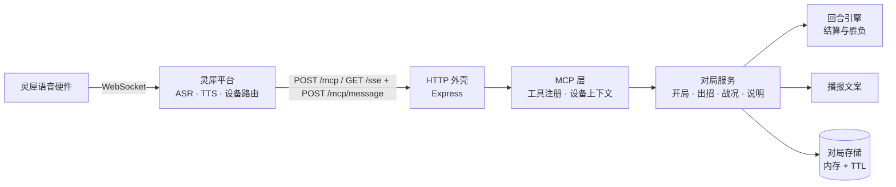

# 共鸣：闻声对决（linx-fighter）

> 灵犀语音硬件上的 1v1 回合制对战。玩家用嘴下令，服务端持有对局并裁定每一手；平台侧只负责听、说和调用工具。

中文名「共鸣：闻声对决」为暂定名；仓库名、包名、`systemd` 单元与镜像名统一用 `linx-fighter`。

当前进度：**框架阶段**。MCP 链路、对局状态管理、语音招式识别与播报已完成并有测试覆盖；命中判定、伤害公式、对手策略、胜负结算仍待接入，接入点集中在 `src/game/engine.ts` 的 `resolveTurn`，见 [docs/game-design.md](docs/game-design.md)。

## 一次语音出招是怎么走完的

1. 玩家对设备说「攻击」，灵犀平台完成唤醒、ASR 与意图理解；
2. 平台把意图交给智能体，智能体调用 MCP 工具 `game_action`，设备与智能体身份通过请求头传入；
3. 服务端按 `deviceId#agentId` 取出对局，识别招式、推进回合、生成播报文本；
4. 平台把返回文本 TTS 给玩家，一回合结束。

所有数值与胜负只以服务端为准（`src/game/engine.ts`），平台侧模型不需要记忆对局状态。

## 核心能力

- **语音即操作，不止认关键词**：口语别名（攻击 / 打 / 砍、闪避 / 躲开、回气 / 调息）、句中夹杂（「我要公鸡你」）、ASR 同音误识别（「公鸡」「工击」→ 攻击，「闪币」→ 闪避）都能命中；每招另有中二唤出指令（「共鸣斩破军」「流光换位」），念出来会被回念一句。
- **认不出不吞回合**：无法识别时不推进回合、不改数值，只提示可选招式。语音错误是常态，不能让玩家白丢一手。
- **没有对局也能直接开口**：首句「攻击」自动开局，降低演示与试玩门槛。
- **对局按「设备 + 智能体」归属**：断线重连、多轮对话不丢对局；不同设备天然隔离。
- **两套传输并存**：Streamable HTTP（`POST /mcp`，平台实测走这条）与 SSE（`GET /mcp` 或 `/sse` + `POST /mcp/message`）；`DELETE /mcp` 直接 200，避免客户端收尾时报错。
- **为「听」而写的播报**：文案口语化、单次两句内，不用 Markdown、列表或 emoji——`content[].text` 会被原样念出来。
- **可替换的存储**：内存 + TTL，接口保持 `get/set/delete/sweep`，需要多实例时换 Redis 实现即可。

## 快速开始

```bash
pnpm install
pnpm dev        # tsx watch，默认 0.0.0.0:8000
pnpm demo       # 不连 MCP，直接看每个指令的播报
```

服务起来后：

```bash
curl http://127.0.0.1:8000/health
pnpm smoke      # 真实调用链自检：initialize → tools/list → 开局 / 出招 / 战况 / 说明
```

其他常用命令：

```bash
pnpm typecheck  # 唯一的静态门禁（没有 lint）
pnpm test       # 单元测试 + MCP 协议端到端
pnpm coverage   # 覆盖率并校验阈值（行 95% / 分支 90% / 函数 95%）
pnpm build      # 编译到 dist/
pnpm start      # 运行编译产物
```

## MCP 接口

### 工具

| 工具 | 玩家说法 | 说明 |
| --- | --- | --- |
| `game_start` | 「开始游戏」「来一局」 | 开一局新对局，覆盖未结束的旧对局；可传 `opponent` 指定对手 |
| `game_action` | 「攻击」「躲开」「回气」「共鸣斩破军」 | 识别招式并推进一个回合，返回播报 |
| `game_status` | 「战况如何」「我还剩多少血」 | 播报双方气血、真气与回合数 |
| `game_help` | 「怎么玩」 | 播报玩法说明 |

工具总数刻意控制在 5 个以内：平台侧模型工具越多越容易选错。

### 端点

| 端点 | 方法 | 用途 |
| --- | --- | --- |
| `/mcp` | POST | Streamable HTTP：直接收发 JSON-RPC，响应为 JSON |
| `/mcp`、`/sse` | GET | 建立 SSE 长连接，先推 `endpoint` 事件给出 POST 地址 |
| `/mcp/message?sessionId=<id>` | POST | 老式 SSE 通道：接收 JSON-RPC，响应从 SSE 流返回 |
| `/mcp` | DELETE | 会话收尾，直接返回 200 |
| `/health` | GET | 健康检查：状态、对局数、运行时长 |
| `/debug/*` | GET/POST | 调试接口：`start` / `action` / `status` / `state`，默认仅非生产环境开启 |

### 身份

设备与智能体身份由平台在请求头注入，**不进工具入参**：

| 请求头 | 含义 |
| --- | --- |
| `X-Linx-Device-Id` | 设备 ID，对局归属的主要依据 |
| `X-Linx-Agent-Id` | 智能体 ID，同一设备换智能体就是另一局 |
| `X-Linx-Session-Id` | 会话 ID，每轮对话刷新 |

### 返回

```json
{
  "content": [{ "type": "text", "text": "第 1 回合，你出了「攻击」。……" }],
  "isError": false
}
```

`text` 就是念给玩家的话。工具不抛异常：业务错误统一转成 `isError: true` + 一句玩家能听懂的中文。

## 语音容错

ASR 在平台侧，同音与近音错误只能由我们兜住。识别按「整句精确 → 子串包含」两段式匹配，包含匹配里长说法优先（避免「闪开」被「闪」截胡）。新增招式时同时补口语别名与常见误识别样例。

| 招式 | 口语别名（节选） | 唤出指令 | 常见误识别 |
| --- | --- | --- | --- |
| 攻击 | 打、砍、斩、劈、揍、出手 | 共鸣斩破军、音波裂空 | 公鸡、工击、攻鸡、公机 |
| 闪避 | 躲、闪、躲开、闪开、防御、防 | 流光换位、回声疾步 | 闪币、朵开、多开、防疫、防预 |
| 回气 | 调息、回血、蓄气、聚气、运功、恢复 | 归元纳息、回响充能 | 回七、回器、回汽、汇气、调西、蓄汽 |

匹配规则集中在 `src/game/actions.ts`；一个唤出词只映射一招，不能影响单字别名（「打」「躲」）的精确匹配。

## 架构



依赖只允许自上而下：`http` → `mcp` → `game` → `store`。`engine` / `narrator` 不 import MCP 或 HTTP，所以 `scripts/demo.ts` 脱离协议就能跑。分层职责、已定决策与扩展指引见 [docs/architecture.md](docs/architecture.md)。

## 配置

全部来自环境变量，参考 `.env.example`：

| 变量 | 默认值 | 说明 |
| --- | --- | --- |
| `PORT` | `8000` | 监听端口 |
| `HOST` | `0.0.0.0` | 监听地址 |
| `LOG_LEVEL` | `info` | `debug` / `info` / `warn` / `error`，日志为单行 JSON |
| `BATTLE_TTL_SECONDS` | `1800` | 对局空闲过期时间 |
| `ENABLE_DEBUG_ENDPOINTS` | 非生产环境开启 | 是否暴露 `/debug/*` |

## 测试与质量

`node:test` + 内置覆盖率，不引入额外测试框架。当前 58 个用例，行覆盖 98.3%、分支覆盖 94.8%、函数覆盖 99.0%；CI 与本地 `pnpm coverage` 都会校验阈值（行 95% / 分支 90% / 函数 95%），低于阈值直接失败。

| 测试 | 覆盖内容 |
| --- | --- |
| `test/actions.test.ts` | 招式表、精确与包含匹配、ASR 误识别、唤出指令、空输入 |
| `test/config.test.ts` | 环境变量解析、默认值与非法值回退 |
| `test/context.test.ts` | 请求头到身份、对局键、头缺失时的兜底 |
| `test/store.test.ts` | 内存存储读写、TTL 过期、容量上限 |
| `test/service.test.ts` | 开局 / 出招 / 战况 / 说明的业务流程与播报 |
| `test/log.test.ts` | 级别过滤、单行 JSON 输出、stderr 分流 |
| `test/tools.test.ts` | 工具注册与业务异常转 `isError` |
| `test/http.test.ts` | 路由、健康检查、SSE 握手、调试接口、404 与非法 JSON |
| `test/streamable.test.ts` | Streamable HTTP：initialize / tools/list / tools/call |
| `test/mcp.e2e.test.ts` | 完整对局链路、多设备隔离、无对局自动开局 |

CI 在 [.github/workflows/ci.yml](.github/workflows/ci.yml)：安装依赖 → 类型检查 → 覆盖率门禁 → 构建产物。

## 部署

演示环境跑在七牛云内网机器 `100.100.61.41`（`linx-fighter.service`，用户 `linx`，代码在 `/opt/linx-fighter`）。内网地址 `http://100.100.61.41:8000/mcp` 平台访问不到，另用 `linx-tunnel.service`（bore 内网穿透）暴露到公网，控制台填 **`http://bore.pub:3216/mcp`**。

```bash
scripts/deploy.sh                 # 编译 → 同步 → 装生产依赖 → 重启 → 自检
systemctl status linx-fighter     # 应用状态
journalctl -u linx-fighter -f     # 实时日志
systemctl status linx-tunnel      # 隧道状态（实际端口见 journalctl -u linx-tunnel）
```

也可以用 Docker：

```bash
docker build -t linx-fighter .
docker run -d --name linx-fighter -p 8000:8000 linx-fighter
```

> bore 公网地址随机分配、随隧道重建变化，仅适用于内部演示；正式上线需要自建反向代理与 TLS，并关闭对 SSE 的缓冲（配置见 [docs/linx-integration.md](docs/linx-integration.md)）。

## 接入灵犀平台

部署、自检、控制台里配置自定义 MCP、智能体设定与可直接粘贴的提示词模板，都在 [docs/linx-integration.md](docs/linx-integration.md)。

## 文档

| 文档 | 内容 |
| --- | --- |
| [README.md](README.md) | 现状、命令、接口、部署 |
| [docs/architecture.md](docs/architecture.md) | 请求链路、分层职责、已定设计决策 |
| [docs/game-design.md](docs/game-design.md) | 玩法施工图：已实现 / 待定 / 每项改哪里 |
| [docs/linx-integration.md](docs/linx-integration.md) | 平台接入、提示词、排障 |
| [AGENTS.md](AGENTS.md) | 给 AI 协作者的仓库规范 |

`docs/xrobot-dev-spec/` 是灵犀平台官方开发文档的整份拷贝，只读、按需单篇查阅。

## 目录结构

```
src/
  index.ts            启动入口：装配依赖、监听端口、优雅退出
  config.ts           环境变量解析
  log.ts              单行 JSON 日志
  game/
    types.ts          数据模型：Fighter / Battle / TurnRecord / ActionResult
    actions.ts        招式定义、口语别名与 ASR 容错
    engine.ts         创建对局、回合结算（玩法机制接入点）
    narrator.ts       播报文案
    service.ts        游戏编排：开局 / 出招 / 战况 / 说明
  mcp/
    context.ts        设备上下文与对局归属键
    server.ts         McpServer 创建与 instructions
    tools.ts          工具注册
  http/app.ts         路由：Streamable HTTP / SSE、健康检查、调试接口
  store/battles.ts    对局存储（内存 + TTL）
scripts/
  demo.ts             脱离 MCP 直接跑播报
  smoke.ts            真实调用链自检
  deploy.sh           内网部署脚本
test/                 单元测试 + MCP 协议端到端测试
docs/                 架构、玩法、接入文档与平台官方文档
```

## 下一步

1. 接入玩法机制：对手行动选择、命中判定、伤害与回气公式、胜负结算（`resolveTurn`）。
2. 数值平衡与播报打磨，调参理由写进 `docs/game-design.md`。
3. PVP：配对与房间独立于现有 1v1，不改 `Battle` 语义；无人可配时 AI 兜底，保证随时能玩。
4. 语音意图决策模型（未选型）：在规则匹配之外加一层「文本 → 招式 + 置信度」，规则匹配始终作兜底。
5. 按需扩展：Redis 存储、对局结算音效（`structuredContent.funcs` 触发 `linx_play`）。
